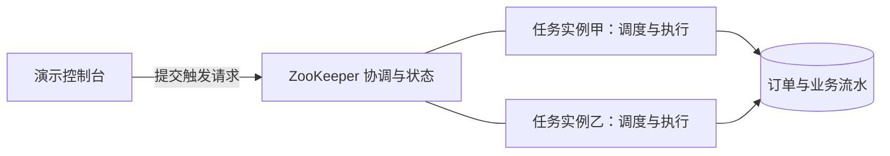

# ElasticJob 分享讲稿：从前端定时器到分片任务

> [!info] 本篇定位与使用方式
> 面向有 Java 基础的同事，是一篇独立的定时任务分享。**主体 37 分钟，问答另留 5 分钟，标准版共 42 分钟。** 用前端经验入门，再通过 12 笔订单讲清任务编写、分片、手动触发和失败恢复。时长不包含安装、拉镜像或等待故障自行消失。

> [!note] 时长核实的边界
> 这是一份具备完整讲述与活动的讲师详稿，时间是排练安排，不是已完成的真人计时记录。无人提问时也应完整讲完主体。紧凑版主体 33 分钟，删减位置见文末；实际彩排使用 [[ElasticJob时长核查与彩排表]]。

## 学习目标与节奏

听完后，听众应能实现一个 `SimpleJob`，解释分片编号和参数，定位一次分片的执行记录，并判断失败该由调度框架还是业务处理。

| 编号 | 内容 | 时间 | 台上必须完成的动作 |
| --- | --- | --- | --- |
| 01 | 前端定时器与独立执行环境 | 3 分钟 | 推演两个页面、两个服务进程 |
| 02 | 调度、执行与生命周期 | 4 分钟 | 画清控制台、应用和注册中心 |
| 03 | 最小 Job 与业务分层 | 4 分钟 | 走读四个实际代码入口 |
| 04 | Cron、时区和公共参数 | 3 分钟 | 解读本例任务定义 |
| 05 | 分片与数据范围 | 6 分钟 | 手算三分片、两实例和两条查询 |
| 06 | 执行、失败与手动补偿 | 6 分钟 | 对照三轮结果与尝试次数 |
| 07 | 分清不同故障恢复 | 3 分钟 | 判断三种故障归谁处理 |
| 08 | 幂等、事务与外部效果边界 | 5 分钟 | 推演两个并发执行者与崩溃窗口 |
| 09 | 模板、观测与上线前检查 | 3 分钟 | 读一条记录，列出任务验收项 |
| 合计 | 主体内容 | **37 分钟** | 不依赖自由问答 |

案例固定使用 ElasticJob 3.0.4、ZooKeeper 和 PostgreSQL，两个任务实例处理三个区域。运行参数在本地应用配置中，不连接配置中心。前端代码仅作类比，完整备稿见 [[前端定时器与ElasticJob类比讲解]]。

## 01｜从一个熟悉的定时回调开始（3 分钟）

```javascript
// refreshOrders 代表刷新列表的业务函数。
setInterval(() => refreshOrders(), 5000);

// Node.js 按时间调度的示意，compensateOrders 代表补偿业务。
schedule.scheduleJob('0 0 * * *', () => compensateOrders());
```

### 可直接讲

> 大家写前端列表轮询时，通常已经接触过定时任务最基础的结构：设置触发规则，到时间调用一个函数。这里要先拆开两件事，什么时候调用，以及调用以后做什么。后面学习 Job，不妨先把它当成一个由调度框架调用的业务入口，就不会被一开始出现的接口和配置类分散注意力。
>
> 现在打开同一个页面的两个标签页，每个页面都注册自己的定时器，它们会各自发起请求。页面之间不会因为调用了同名函数，就自动选出一个负责执行。把这个经验迁移到后端：如果两个进程都注册了同一补偿逻辑，又都扫描全部待处理订单，我们就需要继续处理执行归属和重复操作的问题。
>
> Node.js 的 node-schedule 更接近按日历时间运行任务，但它本身仍是进程内调度。使用 Cron 解决了何时触发，不代表跨进程的工作归属也一并解决。Java 服务里注册一个本地定时器，然后部署两份服务，也会遇到同样需要协调的场景。
>
> 还有一个容易误解的点：JavaScript 的单线程不代表异步请求不会重叠。上一次请求还没返回，下一次定时回调仍可能再次发起请求。我们讨论触发、并行和分布式协调时，要把这几件事分开。今天从定时回调入门，最终要回答谁执行、执行哪部分、失败怎么补、重复怎么防这四个问题。

### 做一次口头推演

“只有一个标签页”和“两个标签页各注册一次”分别有几套触发逻辑？回答后立即迁移到一个服务进程和两个服务进程。此处只解释独立触发，不把浏览器页面当成持久后台执行器。

依据：[Node Schedule 进程内调度说明](https://github.com/node-schedule/node-schedule)、[MDN setInterval](https://developer.mozilla.org/en-US/docs/Web/API/Window/setInterval)。

## 02｜谁负责调度，谁实际执行（4 分钟）



### 可直接讲

> 在实际动手前，先把三个角色放对位置。控制台提供操作入口，应用进程里运行我们的 Job，注册中心参与协调并保存相关状态。不要看到一个页面能点触发，就认为业务代码是在那个页面或者控制台服务里执行。它和前端点击提交、后端真正处理业务的分工很相似。
>
> ElasticJob 的任务实际部署在应用实例中，调度也发生在相应应用里，注册中心提供分布式协调所需的信息。我们会把相同任务定义部署到两个实例，再让它们在同一注册中心命名空间下协调。每个实例要有自己的运行身份，但同一组任务的逻辑名称和配置应保持一致。
>
> 听到这里可以先提出一个问题：如果总分片只有一个，部署两个实例是否就会处理两份相同数据？正常协调下，这一个逻辑分片由一个实例承担，另外的实例可以在后续重新分配时承担它。等会儿把分片数改成概念上的三，就变成多个工作单元由实例分担。这个区别比记住“多实例只跑一份”更准确。
>
> 再看生命周期。关闭一个浏览器页面，不会关闭已经在容器里运行的 Job；停止一个任务实例，也不等于把全部业务记录删掉。业务状态保存在数据库中，下次处理仍然可以据此判断哪些订单待补偿。调度进程、注册中心状态和业务状态属于不同层，发生故障时也要分别观察。
>
> 这也是为什么我们后面既看分片分配，又看订单表和流水表。框架告诉我们某个工作单元安排给了谁，业务表告诉我们某笔订单究竟完成没有。两者提供不同证据，不能拿一个“触发请求已提交”的提示，替代业务结果检查。

### 台上指出实际位置

1. Compose 中的 `app-a`、`app-b` 是两个执行实例。
2. `JobInfrastructure` 使用同一注册中心命名空间和任务名注册任务。
3. 演示台调用实际 `JobOperateAPI.trigger()`，并不绕过框架直接调用业务 Service。
4. PostgreSQL 中的订单、流水和分片调用记录用于业务验收。

这是职责示意图，不展开注册中心内部节点的逐级协议。协调模型依据：[ElasticJob 弹性调度](https://shardingsphere.apache.org/elasticjob/current/en/features/elastic/)。

## 03｜最小 Job 为什么要保持简单（4 分钟）

```java
@Override
public void execute(ShardingContext context) {
    var result = service.execute(context.getShardingItem(),
            context.getShardingParameter(), context.getJobParameter());
    if (result.failed() > 0) {
        throw new IllegalStateException("分片存在失败订单，请查看业务执行记录");
    }
}
```

### 可直接讲

> 现在打开 CompensationJob，只看这个入口。它没有在内部完成全部数据库操作，而是从执行上下文取出当前分片号、分片参数和公共参数，交给业务 Service。这个结构就像前端事件回调先提取事件信息，再调用业务函数。入口越清楚，越容易知道框架给了什么、业务又做了什么。
>
> 接着看 CompensationService。它负责一次分片调用的业务流程：拿到本地运行参数，创建执行记录，判断开关，按区域查询待补偿订单，再逐笔交给处理器。这里的参数来自本地应用配置，本篇不依赖动态配置能力。批量、开关和分片上下文是不同来源，也承担不同职责。
>
> 再进入 OrderProcessor，一次方法调用只处理一笔订单，并在自己的事务里完成状态检查和流水写入。这种粒度意味着前面几笔订单已经成功提交，后面某笔失败时，不会自动把整个区域此前的成功结果全部撤销。重跑时也可以依据每笔业务状态，只处理尚未完成的数据。
>
> 为什么把单笔事务方法放到另一个 Bean？在常见 Spring 代理模式下，调用需要经过代理才能应用相应的事务拦截；同一个对象内部直接调用自己的方法，不能简单地因为那个方法写着注解，就认为代理一定参与了。示例把两个职责分开，也用实际代理调用做了测试。
>
> 最后再回到 Job 入口。我们预期的单笔业务失败会先被记录，循环继续处理本批其他订单，再把存在失败的事实汇总给框架。这样可以同时保留业务明细与框架异常信号。不过数据库等未预期异常会让本分片当前循环中断，不能把“所有失败都逐笔继续”当成通用保证。

### 源码走读顺序

| 文件 | 只看什么 |
| --- | --- |
| `JobInfrastructure.java` | 任务定义与调度器启动 |
| `CompensationJob.java` | 上下文提取与汇总失败 |
| `CompensationService.java` | 查询范围、循环与执行记录 |
| `OrderProcessor.java` | 单笔事务与业务幂等 |

**提问与答案**：“重跑会不会撤销前一轮其他订单的成功？”——本例按单笔事务提交，重跑重新查询待补偿状态，已成功订单不会因此倒退。

### 为什么 Job 最后抛异常，已成功订单却不回滚

> 这里值得停一下：看到入口最终抛出异常，有人会以为整轮十二笔操作都应该回滚。实际上事务范围在单笔处理器里。某笔处理返回时，它自己的事务已经按结果完成；Job 后面的汇总异常不在一个包住整轮的数据库事务中，因此不会把前面已经提交的其他订单全部撤销。
>
> 预期模拟失败也采用了明确的策略：记录尝试次数与错误，保持待补偿状态，然后返回失败结果，这份失败记录会被提交。未预期的数据库异常则可能让当前单笔事务回滚，相关测试验证了这一点。异常是否发生、发生在哪一层、事务覆盖哪一段，是三个要一起看的问题。只盯着最外层有没有 catch 或 throw，无法判断业务数据最终状态。

接口依据：[ElasticJob 作业接口](https://shardingsphere.apache.org/elasticjob/current/en/user-manual/usage/job-api/job-interface/)。事务代理机制可参考 [Spring 事务说明](https://docs.spring.io/spring-framework/reference/6.2/data-access/transaction/declarative/annotations.html)。

## 04｜读懂 Cron、时区与公共参数（3 分钟）

```java
JobConfiguration config = JobConfiguration.newBuilder("order-compensation-job", 3)
    .cron("0 0 0 * * ?")
    .timeZone("GMT+08:00")
    .shardingItemParameters("0=华东,1=华南,2=华北")
    .jobParameter("pending")
    .monitorExecution(true).failover(false).misfire(false)
    .jobErrorHandlerType("LOG").overwrite(true).build();
```

### 可直接讲

> 看任务定义时不要一次把所有开关背下来，先回答名称、时间、范围和参数四件事。名称用于识别同一组逻辑任务；Cron 决定按什么日历规则触发；时区决定规则里的零点是哪一个零点；分片和参数则告诉每次调用它负责的工作。
>
> 本例是每天北京时间零点触发，现场通过手动操作验证，不需要等到明天。Node.js 那个示意用了五字段表达式，这里使用包含秒的六字段表达式，不能直接复制。案例固定使用 ElasticJob 三点零点四，显式时区参数采用 GMT 格式，这是我们实际联调时确认过的版本细节。
>
> pending 是我们自己定义的公共参数，表示当前业务只处理待补偿订单。它不是框架认识的某种内置订单模式；换一个字符串，业务代码必须自己解释，必要时拒绝。分片参数和公共参数也不相同：公共参数每片都收到，分片参数用于区分各片自己的范围。
>
> 这里的 overwrite 为 true，表示教学任务定义以代码为准。实际项目如果允许控制台维护调度配置，就要统一哪个来源具有权威性，避免服务一重启又把运营调整覆盖。时区、任务名和配置来源这些基础项，往往比继续堆更多框架开关更值得先确认。

### 不要混淆三种触发语义

| 写法或操作 | 主要表达什么 |
| --- | --- |
| `setInterval` | 按间隔安排回调，实际执行可能延迟 |
| 完成后再 `setTimeout` | 等本次完成，再等待指定时间 |
| Cron | 按日历规则触发 |
| 控制台手动触发 | 当前提交一次触发请求，仍需观察执行结果 |

**检查点**：让听众指出 `pending` 由谁解析，并说明为什么跨时区部署不能只看“每天零点”。

依据：[ElasticJob Java 配置](https://shardingsphere.apache.org/elasticjob/current/en/user-manual/configuration/java-api/)、[调度 API](https://shardingsphere.apache.org/elasticjob/current/en/user-manual/usage/job-api/java-api/)。

## 05｜分片是怎样变成数据分工的（6 分钟）

### 从前端 filter 建立直觉

```javascript
const regions = ['华东', '华南', '华北'];
const region = regions[shardIndex];
const currentOrders = orders.filter(order => order.region === region);
```

这只是数据范围示意，订单并不在浏览器里执行补偿。

### 可直接讲

> 前端经常把一组数据按类型或区域分组，这个经验可以帮助理解逻辑分片。我们有华东、华南、华北三份工作，所以总分片数是三。当前分片号是工作单元的编号，分片参数是该编号对应的区域。执行者是两个应用实例，所以工作份数和执行者数量并不相等。
>
> 正常情况下，一个实例可以承担多个分片。具体哪片分给哪个实例，以实际协调结果为准，不要把演示时看到的某一种分配写死在业务代码里。将来增加实例或重新分配，业务仍应依据自己拿到的上下文处理，而不是认为甲实例永远处理华东。
>
> 这一步最容易产生的误解，是框架既然已经分片，就会自动把数据库里的订单也分好。实际需要业务自己把分片转成查询条件。我们从上下文取得区域，再只查这个区域的待补偿订单。缺了区域条件，每个分片仍可能扫描全表；协调正确不代表业务查询就一定正确。
>
> 还要确认分片规则既不重叠，也不遗漏。按区域分时，要看有没有未知区域、空区域或新加入的区域不在映射里。按订单号取模时，也要明确总分片数变化是否改变了归属，以及已经处理和待处理数据如何继续接续。今天不展开复杂算法，但要知道选一个分组字段并不是设计的终点。
>
> 数据量不均时，三片也不一定就能让两台机器平均忙碌。假如华东有十万笔，其他区域各一百笔，按区域的工作量会倾斜。它适合教学，是因为范围直观；生产策略还要结合数据分布、数据库查询成本和执行时长来选，而不是单纯把分片数量调得越大越好。

### 第一次推演：分片上下文

| 字段 | 本例 | 业务意义 |
| --- | --- | --- |
| `shardingTotalCount` | 3 | 工作单元总数 |
| `shardingItem` | 0 / 1 / 2 | 当前工作单元编号 |
| `getShardingParameter()` | 华东 / 华南 / 华北 | 负责的数据范围 |
| `getJobParameter()` | pending | 每片共同遵循的处理模式 |

讲师画出一种可能的分配：甲承担 0、2，乙承担 1；再交换一次归属，强调业务代码不应依赖固定机器。

### 第二次推演：批量与完整执行

```sql
SELECT order_id FROM compensation_order
WHERE region = ? AND status = 'PENDING'
ORDER BY order_id LIMIT ?;
```

> 我们的十二笔订单每个区域四笔。如果每片每次最多取两笔，那么一轮最多处理六笔，剩下的数据要在后续触发继续处理。这里的每批数量不是整个集群的全局上限，也不是线程池大小。案例的 Service 一次分片调用查询一批，并不会自动一直循环到全库清空。
>
> 类比 Promise.all 可以帮助理解并行完成几份工作，但它不能替代跨进程的归属协调。分片数、实例数、线程数、批量大小分别是不同维度。如果这些词都被当成同一个“并发数”，后续容量调节和排障就会很混乱。

**推演答案**：三分片、两实例、每片取两笔，本轮最多六笔，不能回答“因为两实例，所以四笔”。此处是纸上推演；默认运行批量为 100，批量限制另有业务测试覆盖。

### 再看一条最容易漏掉的数据

> 如果明天出现第四个区域，但我们仍只注册三份旧区域映射，那笔订单可能不会被任何分片选中。这个问题不会因为框架显示三个分片都成功就消失。业务范围的全集是否覆盖，要由数据规则和验收检查保证。调度成功与业务数据完整处理，不能简单画等号。
>
> 本例公共参数 pending 也有相同边界。它只是输入给业务的一段字符串，当前代码只接受这一种模式。以后新增历史日期、指定订单范围时，需要定义解析、校验和权限，不应该把控制台任意输入直接拼接成查询条件。参数越灵活，越需要知道一次补偿究竟可能影响哪些数据。

依据：[ElasticJob 分片与弹性调度](https://shardingsphere.apache.org/elasticjob/current/en/features/elastic/)、[参数配置说明](https://shardingsphere.apache.org/elasticjob/current/en/user-manual/configuration/)。

## 06｜从触发请求看到真正的业务结果（6 分钟）

详细步骤见 [[ElasticJob演示手册]]，会前完成启动和彩排。台上按“预测 → 触发 → 核对 → 解释”展开，而不是连续快速点击按钮。

### 第一轮：看到 11 成功、1 失败

> 开始前先看基线：两个任务实例在运行，十二笔订单全部待补偿，业务流水为零。我们已经预设订单一零零五会模拟下游超时，所以先预测结果：其余十一笔应该成功，它自己保留待补偿状态。这是业务层的单笔失败，不是实例宕机。

操作：重置后触发，核对两个实例的分片分配、三条分片调用记录、订单状态与流水数量。

> 点击按钮返回的是触发请求已提交，不是补偿已经成功。我们需要继续观察是否有新的执行记录、记录是否结束、业务订单有没有改变。这个过程就像前端收到一个任务受理响应以后，还要继续查询真正处理结果，不能把请求返回成功当成业务已经完成。

### 第二轮：恢复依赖，再次触发

> 现在恢复模拟依赖，再触发一次。这里没有把上次失败的调用栈重新恢复，也没有从框架历史记录里自动拿出那笔订单。每个分片重新执行自己的查询，而查询条件只选择待补偿状态。于是仍然待补偿的一零零五再次被选中，其他已成功订单不再进入处理。

操作：点击恢复依赖与再次触发，逐项核对：12 成功、0 待补偿、12 流水；1005 尝试两次，其他订单一次。

### 第三轮：额外重跑

> 再触发一次，应该没有新增业务流水，也没有新增订单尝试次数。先让大家预测，再看结果。即使新一轮仍有三个分片调用记录，也不代表每片都处理了新订单。调度发生、Job 进入、查询得到数据、实际产生业务效果，是不同层次的事件。

| 轮次 | 成功订单 | 待补偿 | 流水 | 1005 尝试次数 |
| --- | --- | --- | --- | --- |
| 起点 | 0 | 12 | 0 | 0 |
| 第一次触发 | 11 | 1 | 11 | 1 |
| 恢复后触发 | 12 | 0 | 12 | 2 |
| 额外触发 | 12 | 0 | 12 | 2 |

### 用记录解释结果

> 每行执行记录代表一次分片调用，本例为它生成独立的 execution_id。一次触发的三个分片会有三个标识，它不是一个全局批次号。看记录时要一起带上实例、分片、区域、成功数和失败数，这样才能解释为什么一个分片失败，但其他区域已经完成。
>
> 这些记录是我们在业务里持久化的，不是直接展示官方事件追踪表。教学页面调用的触发能力是真的，但页面本身是案例提供的控制台。这两个边界讲清楚，听众在公司原生控制台上找功能时，就不会把本例界面字段当成所有版本都相同的产品承诺。

依据：[ElasticJob 操作 API](https://shardingsphere.apache.org/elasticjob/current/en/user-manual/usage/operation-api/)。

### 如何判断一次观察已经结束

> 演示时不要只截取运行中的某一帧，就断言订单和流水数量不一致。不同分片并行提交，页面又按自己的节奏查询，运行过程中看到中间状态是可能的。我们会等这次新产生的分片记录结束，再对照订单、尝试次数与最终流水数量。这个等待是结果验收的边界，不是把无意义的页面刷新算作分享内容。
>
> 同样，看到某片成功数为零，不一定是异常。额外重跑时，它可能正常执行了查询，但没有待处理订单。判断任务健康要结合预期数据范围和积压量，不能单用“这一轮处理了几笔”判断是否成功。记录让我们解释事实，业务预期决定这些事实是否合理。

## 07｜失败恢复到底有哪几种（3 分钟）

### 可直接讲

> 接下来先不要看到失败就一律说重试。我们区分三种情况。第一种是程序还活着，但某笔业务调用失败，例如刚才模拟的下游超时。第二种是执行这份工作的实例宕机。第三种是上一轮执行时间太长，到下一次触发时还没有结束。这三件事需要的机制并不一样。
>
> 对业务失败，我们记录失败数据和原因，再根据业务设计有限次数的重试、延迟处理或人工恢复。本例选择修复模拟依赖后手动补偿，没有自动退避和最大重试次数。实际项目还需要避免永久失败数据每轮都被高频扫描，可以设计下次重试时间、次数上限和人工处理入口。
>
> failover 面向节点故障时未完成分片的接管；misfire 面向某些错过触发的补执行情形。它们不能替代业务对超时、参数错误或永久失败订单的判断。框架错误处理器选择 LOG，也只是异常处理策略的一部分，不能理解为框架保证业务自动成功。
>
> 主演示关闭了 failover 和 misfire，是为了让大家稳定地看到手动补偿效果。如果要验证节点宕机，需要另外设计一场故障实验，观察检测、接管、业务部分完成和重复执行风险。不能在没有实际演练的情况下，因为某个配置名叫故障转移，就宣称整条业务链已经具备完整灾难恢复能力。

| 故障题 | 应回答什么 |
| --- | --- |
| 1005 超时，实例正常 | 业务补偿与重试策略 |
| 执行实例突然停止 | 节点感知、分片接管或后续分配，仍需业务幂等 |
| 上一轮过长错过触发 | 按需求评估 misfire，不等同于失败订单重试 |

讲师逐题给出答案，无需依靠听众自由发问延长时长。

依据：[failover](https://shardingsphere.apache.org/elasticjob/current/en/features/failover/)、[misfire](https://shardingsphere.apache.org/elasticjob/current/en/features/misfire/)、[错误处理策略](https://shardingsphere.apache.org/elasticjob/current/en/user-manual/configuration/built-in-strategy/error-handler/)。

## 08｜分片之外，为什么还要业务幂等（5 分钟）

### 先从前端防重复说起

> 前端把按钮置灰，或者用 inFlight 标记防止重复请求，是很有用的入口保护。但新开一个标签页，就有另一套变量；换一个服务入口，也可能再次提交。同样，正常分片能减少同一轮的数据重叠，但故障恢复、手动补偿或其他业务入口仍可能让同一订单再次进入处理。
>
> 因此幂等要保护的是业务结果。对于本例，我们希望同一订单最终只产生一条本地补偿流水。它不是说方法永远只被调用一次，而是即使多次进入，已完成的业务效果也不会被重复创建。这个目标比“日志只出现一次”更接近真正需要保证的东西。

### 走读单笔事务

```sql
SELECT * FROM compensation_order WHERE order_id = ? FOR UPDATE;

-- 拿锁后重新判断状态，已成功则跳过。
INSERT INTO compensation_effect(order_id, instance_id) VALUES (?, ?);
UPDATE compensation_order
SET status = 'SUCCESS', last_error = NULL, completed_by = ?
WHERE order_id = ?;
```

以上是便于讲解的 SQL 结构；完整条件判断和事务边界见 `OrderProcessor.java`。

### 可直接讲

> 在外层查询待补偿订单之后，并不能直接认定当前只有自己处理它。另一个执行者可能也拿到了同一个订单号，所以处理器进入事务后，对订单行加锁，再重新检查状态。拿到锁以后发现已经成功，就返回跳过，不会再次插入流水。
>
> 接着把业务流水和订单成功状态放在同一事务里提交。流水用订单号作为唯一键，是另一层约束。这里有几层保护相互配合：查询条件减少无效工作，行锁协调同一订单的并发修改，锁内状态检查判断是否已完成，唯一约束限制重复流水，事务确保本地结果与状态一起提交或回滚。

### 画出两个执行者的时间线

| 时刻 | 执行者甲 | 执行者乙 |
| --- | --- | --- |
| 1 | 查询得到订单号 | 也得到同一订单号 |
| 2 | 取得订单行锁 | 等待该锁 |
| 3 | 写流水与成功状态，提交 | 等待结束后取得锁 |
| 4 | 已完成 | 复查成功状态，跳过 |

> 这条时间线解释了为什么“先查一下状态就行”不够。两个人可能在修改之前都看到待处理。关键是让判断和本地业务效果处在正确的并发控制与事务边界里。本例还有并发测试验证这个业务契约，但正常演示不会故意让不同区域互相抢同一订单。
>
> 最后把本例的能力范围说完整。我们用数据库流水代表业务效果，所以一个数据库事务能够覆盖它。如果业务换成真正的远端退款，退款成功后、本地事务提交前进程突然退出，下一轮仍可能再次请求退款。本地唯一键不能把已经发生的远端操作撤销，也不能自动让远端认识两次请求其实属于同一业务。
>
> 那时要考虑下游幂等键、可靠事件投递、对账补偿等设计，并明确哪个系统记录权威业务结果。今天不展开分布式事务方案，但必须保留这个边界，否则听众可能误以为给表加一个唯一索引，就能保证整个跨系统流程永远只发生一次。

依据：[PostgreSQL 行级锁](https://www.postgresql.org/docs/16/explicit-locking.html)。本例的事务和流水行为同时以实际源码与已有测试为依据。

### 业务唯一键也要匹配真正的操作

> 这里用订单号作为流水主键，是因为案例定义了一张订单只需要一种补偿效果。如果真实业务允许同一订单有多种补偿事件，唯一键可能要包含补偿类型或业务事件号。否则过窄的唯一键会误拦合法操作，过宽的唯一键又可能挡不住重复。幂等首先是识别同一个业务操作，之后才是选择数据库约束和事务手段。

## 09｜怎样把任务写成可维护的模板（3 分钟）

### 可直接讲

> 一段任务代码能运行，只是完成了第一步。它上线以后，还需要让别人回答昨天有没有执行、哪一片失败、处理了哪些业务键、现在能不能重跑。如果只留一句任务开始和任务结束，遇到部分完成时通常不足以定位问题。
>
> 本例每次分片调用记录执行标识、实例、分片、区域、参数、开始结束时间和结果数量。日志再带上订单号，方便从某一笔失败回到具体执行。这个执行标识是分片调用级别的，如果团队需要跨分片的全局批次，还要另外设计，不能把三个独立 UUID 直接当成同一个批次。
>
> 对失败处理，还要想运行记录停在 RUNNING 的情况。进程如果在写入开始记录之后突然消失，finally 不一定有机会执行，所以生产任务可能需要超时识别、心跳或对账修复。单看状态没有结束，不应该永远阻塞所有后续操作，也不能不检查就把它标为成功。本案例没有实现完整的生产运行记录治理，这属于迁移时要补的内容。
>
> 最后沿着模板检查：任务定义由谁管理、每片查哪些数据、单笔事务在哪里、失败会如何保留、重跑范围怎么确定、结果如何验证。把这六件事写出来，比复制一个类名再修改 Cron 更能帮助团队稳定地新增任务。

### 用模板收尾

打开 [[ElasticJob任务代码模板]]，核对这四项最小验收：

1. 正常执行时，每个业务键进入预期的数据范围。
2. 一笔失败后，已成功数据的结果能保留，失败数据可识别。
3. 修复后重跑，可以完成待处理数据。
4. 额外或并发执行，不重复产生本例的本地业务效果。

**离场问题与答案**：“再部署一个实例，是不是任务就安全了？”——还要检查同一组协调配置、分片查询范围、故障策略和业务幂等，实例数量本身不能代替这些设计。

## 问答与补充（5 分钟，可选）

以下内容不计入 37 分钟主体。

**一个分片是不是永远由一台机器执行？** 不是，归属会受实例变化和协调结果影响，业务应依据上下文，而不是写死机器与区域。

**setInterval 的异步回调会等上一轮吗？** 不会自动等待返回的 Promise。递归 setTimeout 配合 await 可以表达完成后再等待，但它仍然是当前执行环境里的控制方式。参考：[MDN 执行耗时说明](https://developer.mozilla.org/en-US/docs/Web/API/Window/setInterval#ensure_that_execution_duration_is_shorter_than_interval_frequency)。

**控制台重跑是不是只重跑失败片？** 本例再次触发任务，各片重新查询待补偿数据；不是专门的历史失败片回放功能。公司控制台如有额外封装，需要按具体产品核对。

**可以自动重试吗？** 可以设计，但要明确次数、退避、永久失败与幂等。该案例没有自动重试队列，不应把当前手动补偿当作已实现的自动重试策略。

## 紧凑版与延伸版

需要压缩时，从 02 的生命周期讨论、03 的分层走读、04 的触发语义对照、09 的观测扩展各减少 1 分钟，主体仍为 **33 分钟**。保留分片数据范围、三轮业务结果和幂等时间线。

有 45 分钟以上时，增加“任务结束后停掉实例乙，再观察下一次分片分配”的实验。它展示后续重新分配，不证明执行中立即 failover；此实验不用于补足主体时长。
