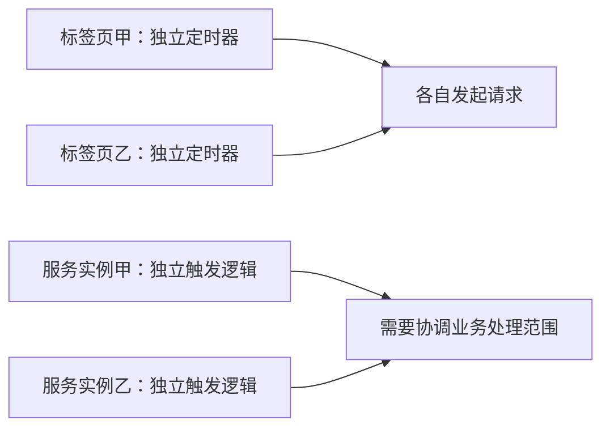

# 用前端定时任务理解 ElasticJob

> [!abstract] 讲解主线
> 从订单列表轮询开始，再过渡到 Node.js 的按时间调度，最后引入多个服务实例的分工。先让听众理解“触发与业务分开”，再回答“谁来跑、跑哪部分、失败怎么补、重复怎么防”。

本文用于备课与问答，本篇现场使用 [[ElasticJob分享讲稿]] 中的精简类比内容。

## 一、第一层：什么时候调用一个函数

前端轮询订单列表：

```javascript
// 示意代码：refreshOrders 表示刷新列表的业务函数。
setInterval(() => refreshOrders(), 5000);
```

讲述：“我们先把什么时候执行和执行什么分开。定时器安排回调，回调调用业务函数。Java 中的任务入口也可以这样理解。”

`setInterval` 表达间隔触发，实际执行可能延迟；业务要求“每天零点”，则需要使用日历式调度规则。参考：[MDN setInterval](https://developer.mozilla.org/en-US/docs/Web/API/Window/setInterval)。

## 二、第二层：每天几点执行

Node.js 服务中的熟悉写法：

```javascript
import schedule from 'node-schedule';

// 五字段 Cron：每天本地时间零点。
schedule.scheduleJob('0 0 * * *', () => compensateOrders());
```

Java 案例相应的规则为：

```java
// 包含秒的六字段 Cron；固定北京时间。
JobConfiguration.newBuilder("order-compensation-job", 3)
    .cron("0 0 0 * * ?")
    .timeZone("GMT+08:00");
```

两段代码用于对照概念，Java 片段不是完整注册代码；可运行实现见案例中的 `JobInfrastructure.java`。

| 前端或 Node.js 的经验 | 在 Java 案例里怎么理解 |
| --- | --- |
| 注册定时任务 | 定义任务配置并启动调度 |
| 回调函数 | `SimpleJob.execute(context)` |
| 调用业务函数 | Job 调用 Service |
| 业务函数参数 | 通过执行上下文与业务配置传入 |
| 调度规则 | Cron 和时区 |

Node Schedule 是进程内调度器；它本身不提供跨进程的任务归属协调，不能因为使用了 Cron 就认为多实例会自动只执行一份。参考：[Node Schedule 官方文档](https://github.com/node-schedule/node-schedule)。

## 三、第三层：打开两个页面，会不会各自触发

先抛出问题：

> “同一段轮询代码，开两个标签页，会有几套定时器？”

答案是每个页面各注册一套。由此过渡：如果两个服务进程都注册了同一补偿任务，并都查询全部待补偿订单，就可能处理相同数据。



这个类比解释的是独立执行环境与各自触发。浏览器生命周期、页面节流与服务进程运行环境不同，不能把浏览器页面直接当成持久后台任务执行器。

## 四、第四层：把全量订单分成几份

前端常见的数据分组可以帮助理解分片：

```javascript
const regions = ['华东', '华南', '华北'];

function selectOrders(orders, shardIndex) {
  const region = regions[shardIndex];
  return orders.filter(order => order.region === region);
}
```

对应到案例：

| 概念 | 类比 | 本例 |
| --- | --- | --- |
| 逻辑工作单元 | `regions` 中的一个元素 | 一个区域 |
| 总分片数 | 工作单元数量 | 3 |
| 分片编号 | `shardIndex` | 0、1、2 |
| 分片参数 | 当前编号对应的值 | 华东、华南、华北 |
| 执行实例 | 承担工作单元的执行者 | 开发实例甲、乙 |
| 数据过滤 | `filter` | 按区域和待补偿状态查询数据库 |

“三份数据可以由两个人分担，一个人处理两份，另一个人处理一份。这里工作份数对应分片数，处理者数量对应实例数。”

ElasticJob 分配分片，业务代码决定每片的数据范围。分片数不能直接等同于机器数、线程数或 `Promise.all` 的并发数量。参考：[ElasticJob 弹性调度](https://shardingsphere.apache.org/elasticjob/current/en/features/elastic/)。

## 五、第五层：重新执行时，要重新处理哪些订单

前端类比：“刷新失败后点重试，会再次进入处理函数；这次请求携带的参数、服务端保存的状态，决定实际做什么。”

对应本案例：

1. 第一次触发处理 12 笔待补偿订单，1005 失败并保留待补偿状态。
2. 恢复模拟依赖后再次触发，各分片重新查询待补偿订单。
3. 只有 1005 再次进入实际处理；已成功的订单没有重复产生流水。

手动触发不是框架自动回放历史失败输入；历史日期、订单范围等需求，需要业务明确定义参数和执行记录。

## 六、第六层：前端防重复与业务幂等的区别

前端常见做法：

```javascript
let inFlight = false;

async function handleRetry() {
  if (inFlight) return;
  inFlight = true;
  try {
    await retryCompensation();
  } finally {
    inFlight = false;
  }
}
```

这是当前页面内的重复提交保护。新标签页有自己的变量，另一个服务实例也不会共享它。

案例把保护放在业务状态与数据库事务中：订单行锁、拿锁后状态复查、业务流水唯一键、流水与成功状态原子提交。这样即使同一订单被重复提交，也能保持本地业务效果正确。

本例只覆盖同库效果；真实远端退款仍要有下游幂等键与对账恢复。

## 七、几个需要避免的类比

| 容易产生的说法 | 更准确的讲法 |
| --- | --- |
| ElasticJob 就是 setInterval | 定时回调是入门类比，ElasticJob 还承担分片协调等职责 |
| JavaScript 单线程，异步任务就不会重叠 | 异步请求可以在前一请求未完成时再次发起 |
| 用递归 setTimeout 就解决了分布式互斥 | 它可帮助串行轮询，跨进程归属需要额外协调 |
| 三个分片就是三台机器 | 分片是逻辑工作单元，可由不同数量实例分担 |
| 禁用按钮就实现了幂等 | 它保护当前入口，业务幂等还要在服务端实现 |
| misfire 就是失败重试 | 它处理错过的触发，业务异常需要单独设计恢复 |
| 分片调度保证业务效果绝不重复 | 故障、重跑与外部副作用仍需要业务幂等 |

异步轮询与递归 `setTimeout` 的区别参考 [MDN 执行耗时说明](https://developer.mozilla.org/en-US/docs/Web/API/Window/setInterval#ensure_that_execution_duration_is_shorter_than_interval_frequency)。

## 八、可以直接使用的收尾话术

“前端定时器帮助我们理解什么时候调用函数。到了后端多实例环境，还要继续回答四个问题：谁执行、执行哪部分、失败后如何补、重复执行如何保持结果正确。这就是接下来分片、补偿和幂等要解决的问题。”
