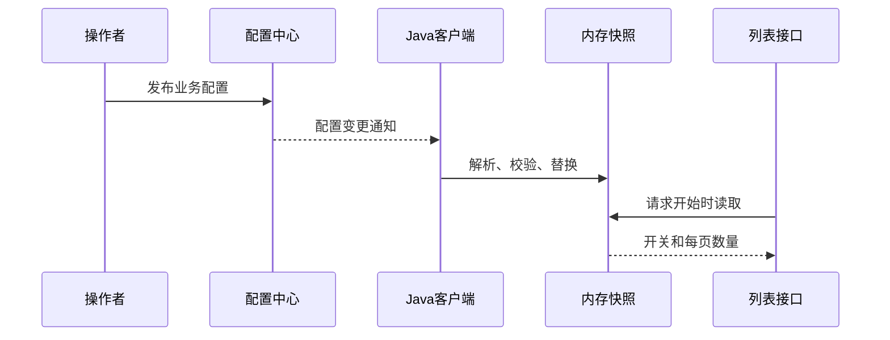

# 配置中心分享讲稿：从前端配置到 Apollo / Nacos

> [!info] 本篇定位
> 这是独立的一篇配置中心分享，面向有 Java 基础的同事。建议 30 分钟含演示与问答。业务场景为订单列表开关与每页数量，演示不依赖任何定时任务。

## 分享节奏

| 环节 | 时间 |
| --- | --- |
| 需求引入 | 2 分钟 |
| 前端配置类比 | 4 分钟 |
| Apollo / Nacos 配置定位与环境隔离 | 5 分钟 |
| 读取、订阅与动态刷新 | 5 分钟 |
| 现场演示 | 8 分钟 |
| 配置命名规则 | 4 分钟 |
| 问答 | 2 分钟 |

## 第一部分：为什么需要配置中心（2 分钟）

开场：“订单列表功能暂时要关闭，恢复后每次只返回 3 笔数据。能不能不修改代码、不重启应用就完成？测试环境又能不能保持原来的值？”

本篇要完成三个结果：添加并发布业务配置、观察动态刷新、验证环境隔离。最后带走一份 [[配置中心命名规则]]。

## 第二部分：用前端经验理解 Apollo（4 分钟）

先展示熟悉的写法：

```javascript
const apiBase = import.meta.env.VITE_API_BASE;
```

“这是把配置从代码中分离。Vite 在生产构建时静态替换这些值，已经发出去的旧资源不会因为改了 `.env` 就自动更新。”依据：[Vite 文档](https://vite.dev/guide/env-and-mode)。

再展示运行时读取远程开关的概念：

```javascript
const config = await fetch('/api/runtime-config').then(response => response.json());
if (config.orderListEnabled) showOrderList();
```

“这更接近动态配置：管理端发布，运行中的应用收到或重新读取，再改变行为。Apollo 可以从这个远程配置平台的角度理解。”

说明前端仍需要自己的刷新机制，单次 fetch 不会持续接收变化。完整类比与备课话术见 [[Apollo与前端配置类比]]。

## 第三部分：先找到正确的配置（5 分钟）

Apollo：AppId 标识应用，Environment 表示环境，Cluster 组织部署集群，Namespace 组织配置组，再通过 Key 读取值。

Nacos：本案例通过 Namespace 隔离开发、测试，用 Group 组织订单服务配置，通过 Data ID 选择配置集。

| 问题 | Apollo | 本案例 Nacos |
| --- | --- | --- |
| 哪个应用或业务 | AppId 与 Namespace | Group 与 Data ID 的命名约定 |
| 哪个环境 | Environment 及对应服务地址 | `share-dev` / `share-test` |
| 哪组配置 | Namespace，配合 Cluster | `ORDER_SERVICE` + `order-list.yaml` |
| 哪个属性 | 配置 Key | `order.list.enabled` 等 |

两者 Namespace 的含义不同，不能直接按名称互换。参考：[Apollo 客户端指南](https://github.com/apolloconfig/apollo/blob/master/docs/en/client/java-sdk-user-guide.md)、[Nacos 配置模型](https://www.nacos.io/docs/ebook/szf3gh/)。

业务配置示例：

```yaml
order:
  list:
    enabled: false
    page-size: 100
```

“环境隔离后，同样的配置项名称在开发和测试里可以保存不同值。应用要显式连接到正确的环境空间。”

## 第四部分：发布后如何让业务用上新值（5 分钟）



打开 `NacosConfigClient.java`：

```java
public void receiveConfigInfo(String configInfo) {
    store.apply(configInfo);
}
```

再打开 `ConfigStore.java`：它把两个字段解析成不可变快照，校验页大小为 1～1000，成功后通过 `AtomicReference` 一次替换。失败则保留上次有效值，并暴露拒绝原因。

“Java 业务每次请求读取当前快照，就像前端收到新配置后更新自己的状态。但后端需要的是业务读取新值，而不是 React 界面重新渲染。”

Apollo 的读取、监听也有相应 SDK 入口。具体 Spring 绑定方式是否自动更新，需要按客户端版本与绑定方式确认。本案例用 Nacos 原生 SDK 显式展示链路，参考：[Nacos Java SDK](https://nacos.io/docs/latest/manual/user/java-sdk/usage/)。

## 第五部分：现场演示（8 分钟）

按 [[配置中心演示手册]] 操作：

1. 展示三个实例：开发甲、乙为 `false / 100`，测试为 `false / 7`，列表接口当前返回 0 笔。
2. 记录开发实例的启动标识和配置版本。
3. 发布开发配置 `true / 3`，两个开发实例都采用新配置。
4. 请求列表接口，实际返回 3 笔订单；启动标识不变。
5. 测试实例仍为 `false / 7`，展示同名配置集在两个环境中的不同值。
6. 在 Nacos 原生控制台把开发页大小改成 2 并发布，返回数量变成 2。
7. 将页大小改成 0，观察实例拒绝原因，业务继续使用上次有效值。
8. 改回合法值或恢复初始配置，解释回滚也要验证业务实际采用情况。

结束语：“我们观察了已发布、客户端收到、业务响应改变、应用未重启这几个证据。”

## 第六部分：配置命名与使用规范（4 分钟）

展示 [[配置中心命名规则]]，重点讲：

- `业务域.功能.属性`，例如 `order.list.page-size`。
- 类型、范围、默认值、负责人、生效时机都要明确。
- 环境由平台隔离维度表达，业务 Key 保持相同名称。
- 普通业务开关适合动态刷新，已创建的连接池等资源还需要重建支持。
- 多实例接收配置存在传播时间，需要观察各实例的版本。

## 问答（2 分钟）

**Apollo 能直接理解为远程 `.env` 吗？**

可以借 `.env` 理解配置外置，再用远程开关解释运行时更新；两者的生效阶段与刷新能力不能混在一起。

**配置已经保存，为什么接口没变化？**

核对配置位置、是否发布、实例是否收到、校验是否拒绝、业务是否在读取旧对象。

**浏览器是否直接读取全部 Apollo 配置？**

本例是后端 SDK 订阅，浏览器通过业务接口观察结果。如果前端需要业务开关，接口只返回可公开的配置字段。

**演示用 Nacos，Apollo 是不是没讲？**

本篇讲清两种配置模型，并用 Apollo SDK 的读取与监听对照；可运行案例选 Nacos，避免现场部署两套配置平台。若团队实际采用 Apollo，可以按相同业务场景替换客户端接入。
