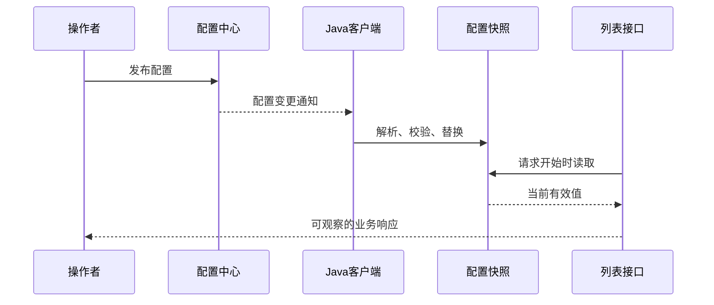

# 配置中心分享讲稿：从前端配置到 Apollo / Nacos

> [!info] 本篇定位与使用方式
> 面向有 Java 基础的同事，是一篇独立的配置中心分享。**主体 37 分钟，问答另留 5 分钟，标准版共 42 分钟。** 按每节的讲述、源码走读、结果推演和演示展开，时长不包含安装软件、拉镜像或故障等待。以下是讲师详稿，不需要把所有文字放进幻灯片。

> [!note] 时长核实的边界
> 这里给出内容量核查与排练安排，不冒充真人计时彩排。没有听众提问时，仍按主体完整讲述；紧凑版保留 33 分钟主体内容，删减位置见文末。会前请使用 [[配置中心时长核查与彩排表]] 实际计时。

## 学习目标与节奏

听完后，听众应能新增并定位一份配置、解释变更进入业务的路径、排查发布后不生效的问题，并为一个动态配置项写清使用规范。

| 编号 | 内容 | 时间 | 台上必须完成的动作 |
| --- | --- | --- | --- |
| 01 | 业务需求与配置边界 | 3 分钟 | 对比代码常量、本地配置、远程配置 |
| 02 | 前端类比与生效阶段 | 4 分钟 | 推演“改 .env，旧页面会不会变” |
| 03 | Apollo / Nacos 配置定位 | 5 分钟 | 找出开发与测试两份同名配置 |
| 04 | 读取与订阅的完整路径 | 5 分钟 | 走读客户端、回调与业务读取点 |
| 05 | 快照、校验与生效时机 | 6 分钟 | 推演混合版本与非法值两种情况 |
| 06 | 正常变更演示 | 5 分钟 | 证明业务改变且应用未重启 |
| 07 | 错误配置、环境隔离与回滚 | 4 分钟 | 按证据链定位一次异常 |
| 08 | 命名与发布规范 | 3 分钟 | 共同完善一个配置项说明 |
| 09 | 用完整链路复述案例 | 2 分钟 | 从新增配置讲到业务验证 |
| 合计 | 主体内容 | **37 分钟** | 不依赖自由问答 |

业务案例固定为订单列表功能开关与每页数量。可运行案例使用 Nacos 2.5.1；Apollo 用于配置模型、SDK 与前端类比的对照，未打包 Apollo 服务端。

## 01｜先说业务要改变什么（3 分钟）

### 可直接讲

> 今天先不从配置中心的产品介绍开始。假设我们有一个订单列表，业务希望先临时关闭，恢复后每次只返回三笔数据。我们要解决的第一件事，是把这两个业务决定从代码中取出来。第二件事，是在应用已经运行的情况下调整它们。第三件事，是让测试环境保持自己的值，不被开发环境的操作影响。
>
> 最容易理解的实现，是在代码里写一个布尔常量和一个数字。这种方式很直观，编译时也容易检查，但每次修改都要走代码发布。接着我们可能把它们放到本地配置文件。这时配置和业务代码分开了，不过运行中的程序是否会重新读取，仍然需要具体机制。本地文件变化，不会凭空让一个已经创建的 Java 对象自动重建。
>
> 配置中心进一步解决的是管理与分发：我们到一个统一的位置找配置、修改、发布，应用通过客户端获取或订阅变化。但是，配置管理平台和业务程序各自有职责。平台负责保存和发布，应用负责解析、校验、采用新值。今天最重要的，就是把这条责任链看清楚。
>
> 在这个案例里，订单本身只是十二笔演示数据。我们不会引入数据库、定时任务或者其他业务系统，避免学习目标散掉。能看到的变化是：关闭开关，列表接口返回空列表；开启开关并设置每页三笔，接口就返回三笔。后面所有概念都围绕这一个变化展开。

### 先做一个分类

| 内容 | 是否适合作为本例动态配置 | 理由 |
| --- | --- | --- |
| 列表功能开关 | 适合 | 业务在请求开始时决定是否开放 |
| 单次返回数量 | 适合 | 数值范围明确，可在请求中读取 |
| 当前用户订单是否付款 | 不作为配置项 | 属于业务数据，需要业务状态管理 |
| 已创建数据库连接池的参数 | 需要组件支持 | 修改值后可能还需要重建资源 |

**提问与参考答案**：“只要值可能变，就都应该放到配置中心吗？”——不应该，还要看它属于配置还是业务数据、变化频率、权限和生效方式。无人回答时，讲师用表中四项直接完成分类，不留空等候。

**本节落点**：动态配置解决特定业务参数的管理与运行时采用问题，不等于所有状态都交给配置中心。

## 02｜用前端经验解释 Apollo（4 分钟）

### 从熟悉的写法开始

```javascript
// Vite 项目的构建环境变量示意。
const apiBase = import.meta.env.VITE_API_BASE;

// 运行时远程配置示意，showOrderList 代表业务函数。
const config = await fetch('/api/runtime-config').then(response => response.json());
if (config.orderListEnabled) showOrderList();
```

### 可直接讲

> 大家可能更熟悉前端的 .env。比如开发环境连接测试接口，生产环境连接正式接口。它很适合帮助理解一件事：同一套业务代码，可以通过外部参数适配不同环境。Apollo 中的应用身份、环境与配置分组，也是在回答应用应该读取哪些配置。
>
> 不过这里要把生效阶段分清楚。以 Vite 为例，生产构建会把相应环境变量静态替换进产物。你在服务器上修改另一份 .env，已经下载到浏览器的旧代码不会因此自行改变。这说明配置外置和运行时刷新不是一回事。不能因为两边都有一个开关，就认为它们的更新方式相同。
>
> 第二段代码更接近动态配置：页面运行时向接口拿一份配置，再决定是否展示列表。假如运营后台把开关改了，这个页面何时采用新值，取决于它有没有重新获取、有没有推送通知、是否更新了页面状态。只在页面加载时 fetch 一次，仍然不会自动感知之后的变更。
>
> 所以介绍 Apollo 时，我会先把它类比成一个统一管理、发布远程配置的平台。前端的 feature flag 帮助理解业务效果，远程配置帮助理解读取时机，SDK 的变更回调帮助理解更新通知。但接到通知之后，业务如何校验和使用新值，还是应用自己要完成的部分。
>
> 在本例中，浏览器页面只是观察后台结果。真正连接 Nacos、接收配置变化、更新内存快照的，是 Java 应用。即使把演示页面关掉，已经运行的客户端也不靠这个页面才能接收通知。如果前端需要某些功能开关，可以通过业务接口获得允许公开的字段，不把后端全部配置直接暴露出去。

### 三种生命周期对照

| 类型 | 何时得到值 | 想改变运行效果，还需要什么 |
| --- | --- | --- |
| 构建变量 | 构建阶段 | 重新构建并交付相应资源 |
| 运行时拉取一次 | 当前请求或页面加载 | 下一次读取，或另外设计通知机制 |
| SDK 订阅 + 业务采用 | 客户端收到变更后 | 校验、更新对象、明确业务读取时机 |

**推演**：“后台改了开关，但页面只在首次加载取过配置，为什么还没变？”——配置已更新，不代表所有消费者已经重新读取。这个答案后面同样适用于 Java 对象。

### 再用一个前端常见错误解释类型

> 前端还有一个很适合拿来类比的细节：环境变量看起来写着 false，读取出来却可能是字符串。把这个字符串直接用于真假判断，可能和原本想表达的布尔值不同。因此配置的名字和文本看起来正确，还要确认消费者按照什么类型解释它。
>
> 本例的 YAML 解析明确要求 enabled 是布尔值，页大小是整数。写成带引号的 false 会成为字符串，会被当前校验器拒绝。这不是说所有配置平台只能使用同一种底层表示，而是接入层必须完成清楚的类型转换，再交给业务。换成 Apollo 的属性读取，也应当沿用相同业务约束，而不是把某个平台返回文本的方式直接带进业务判断。

这个例子用来解释类型边界，不要求现场修改更多字段。Vite 的环境变量字符串行为也见下方官方文档。

依据：[Vite 环境变量说明](https://vite.dev/guide/env-and-mode)、[Apollo Java 客户端指南](https://github.com/apolloconfig/apollo/blob/master/docs/en/client/java-sdk-user-guide.md)。

## 03｜先找到正确的一份配置（5 分钟）

### 可直接讲

> 接入时最常见的问题之一，不是客户端完全连不上，而是连接到了一个可以访问、但不是预期的位置。控制台里看到一份配置，并不能说明当前实例就在读取这一份。我们需要先把配置的坐标说清楚，再讨论值为什么没有刷新。
>
> Apollo 里，AppId 标识应用；Environment 表示环境；Cluster 可以组织同一环境中的部署集群；Namespace 组织一组配置。这里先记住各自回答的问题，不要求把整个平台架构背下来。对于一个订单服务，我们可以说：这是哪个应用，在什么环境、什么部署分组里，读取哪一个模块的配置。
>
> Nacos 的模型要单独看。本例用 Namespace 隔离开发和测试，用 Group 组织订单服务的配置，再由 Data ID 指定配置集。相同的 Group 和 Data ID，可以分别存在于两个 Namespace。于是开发和测试可以使用同样的业务 Key，但保存不同的值。
>
> 这里有一个容易混淆的地方：两个产品都出现 Namespace 这个词，但职责和层级并不相同。我们做对照，是为了理解问题，不是把同名字段直接互相替换。实际迁移客户端时，要把每个字段放回产品自己的配置模型里看。
>
> 另一个常见误解，是认为切换 Spring Profile 就一定完成了远程环境隔离。Profile 可以参与我们组织启动参数，但最终还是要检查客户端实际使用的服务地址和配置空间标识。程序启动时选错 Namespace，即使配置 Key 拼写完全正确，也会读到另外一个环境的值。

### 把坐标写出来

| 平台 | 示例坐标 | 说明 |
| --- | --- | --- |
| Apollo | AppId=`order-service`，Environment=`DEV`，Cluster=`default`，Namespace=`order-list` | 理解用的概念示例，非本例部署参数 |
| Nacos 开发 | Namespace=`share-dev`，Group=`ORDER_SERVICE`，Data ID=`order-list.yaml` | 本例实际连接位置 |
| Nacos 测试 | Namespace=`share-test`，其余相同 | 本例环境隔离对照 |

### 台上定位练习

在原生 Nacos 页面完成以下三步，并指出对应的客户端启动参数：

1. 选择开发命名空间，找到 `ORDER_SERVICE / order-list.yaml`。
2. 切换测试命名空间，找到同名配置集，观察每页数量为 7。
3. 打开 `application.yaml`，再看 Compose 传入的 Namespace，确认实例甲、乙和测试实例的区别。

**可直接补充**：

> 我们这里的隔离证据，不是配置项里多写了一个 dev 或 test 字符串，而是三个实例实际选择了不同的配置空间。平台隔离、客户端连接信息和访问权限需要一起设计。本地演示为了便于观察关闭了鉴权；生产接入时不能把演示环境的权限方式直接复制过去。

**提问与参考答案**：“两个环境都叫 `order-list.yaml` 会不会覆盖？”——在本例的两个 Namespace 中，它们是两份不同配置。发布时依然要确认目标坐标。

依据：[Nacos 配置模型](https://www.nacos.io/docs/ebook/szf3gh/)、[Apollo 环境与客户端设置](https://github.com/apolloconfig/apollo/blob/master/docs/en/client/java-sdk-user-guide.md)。

## 04｜沿着代码找到读取、订阅和使用（5 分钟）

### 先画出一条完整链路



### 可直接讲

> 接下来我们不一次性展开所有类，而是沿着数据流找三个位置。第一处是客户端初始化，它决定去哪儿取。第二处是监听回调，它决定变化到来后交给谁。第三处是业务接口，它决定新请求究竟从哪儿读值。这三处连起来，才能解释动态刷新是如何发生的。
>
> 打开 NacosConfigClient，可以看到服务地址和 Namespace 被写入客户端参数，Group 和 Data ID 在读取时传入。这里使用带监听器的获取接口：启动时取得配置内容，同时为后续变更注册回调。初始内容也要进入同一个配置仓库处理，不能只给后续变更做校验，而启动时直接信任任何输入。
>
> 再看回调，里面没有直接处理订单，也没有重启 Spring 容器，只是把配置文本交给 ConfigStore。这样客户端接入和业务参数处理就分开了。后续如果团队使用 Apollo，需要替换的主要是读取、监听的适配层，业务校验和业务读取的原则仍然可以保留。
>
> 最后找到列表接口，它在一次请求开始时取当前快照，再用开关和每页数量决定响应。这一步特别关键。如果业务类在创建时把旧值复制到自己的普通字段，后面永远不再读快照，客户端即使已经收到更新，业务行为也可能保持不变。排查时不能只停留在监听器有没有日志。

### 源码走读顺序

```java
// NacosConfigClient.java 中的接入入口，省略已在源码给出的参数准备。
String initial = service.getConfigAndSignListener(dataId, group, 10000, listener);

// 监听器将新内容交给配置仓库。
public void receiveConfigInfo(String configInfo) {
    store.apply(configInfo);
}

// ConfigController.java 中，每个请求读取一次当前有效快照。
ConfigStore.Snapshot snapshot = store.snapshot();
```

**Apollo 接入对照，属于接口示意而非本 Docker 案例代码**：

```java
Config config = ConfigService.getConfig("order-list");
config.addChangeListener(event -> refreshBusinessConfig(config));
refreshBusinessConfig(config);
```

`refreshBusinessConfig` 表示业务自己的读取、校验与刷新函数。不能把这段示意当作一个完整可运行的 Apollo 接入类。

> 如果使用 Spring 的配置注入，还要按绑定方式看更新行为。Apollo 对支持的占位符注入提供自动更新能力，ConfigurationProperties 等绑定需要配套刷新处理。今天显式展示 SDK 和快照，目的就是让大家能看见边界，而不是只记住一个注解，以为它能自动重建所有业务资源。

**检查点**：讲师在三个源码位置各停一次，让听众用“定位、接收、使用”复述职责。无需临时翻阅整个依赖源码。

### 对照一次“客户端已刷新，业务还没变”的反例

```java
// 反例示意：只记住当前对象，后续一直使用它，而不再读取 store。
ConfigStore.Snapshot remembered = store.snapshot();
```

> 这个引用在创建时指向哪一份快照，之后就仍然指向那份对象。配置仓库保存的引用被替换，不代表所有以前取出去的变量都会自动指向新对象。前端拿到旧状态对象、闭包里继续使用旧值，也可以帮助理解这种“更新发生了，读取路径没有跟上”的现象。
>
> 因此我们在列表接口开始时再读取当前快照，把更新边界放在每个请求上。这个选择有明确的行为：同一个请求中的两个字段来自同一快照，而新请求能使用新快照。排查时，沿调用链看到的最后一个有效版本比单纯看到一个配置刷新日志更有说服力。

依据：[Nacos 读取与监听接口](https://nacos.io/docs/latest/manual/user/java-sdk/usage/)、[Apollo Spring 绑定与更新说明](https://github.com/apolloconfig/apollo/blob/master/docs/en/client/java-sdk-user-guide.md#322-use-of-spring-placeholder)。

## 05｜为什么需要完整快照与校验（6 分钟）

### 可直接讲

> 现在假设客户端已经把变化送到了应用，我们还不能立即把所有字段随意改掉。开关和页大小是关联的两个值。旧配置是关闭、一百，新配置是开启、三。如果用两个独立字段分别赋值，某个请求可能在第一次赋值之后、第二次赋值之前进入，短暂读到开启、一百。这不是我们准备发布的那一组值。
>
> 本例先解析出一个完整的新对象，确认类型和范围都正确，再一次替换保存它的引用。请求开始时也只读取一次引用。这样，某个请求用到的是旧快照，或者新快照，不会把两份快照中的字段混在一起。它解决的是单个进程、一次读取中的一致性问题。
>
> 这里也要把边界说清楚：甲实例先收到、乙实例稍后收到，是另外一个问题。单个 AtomicReference 不能让两个进程在同一瞬间切换。我们的处理方式是暴露当前有效配置的版本，让操作者能观察传播结果。对严格要求同时生效的业务，还需要额外的版本协调或生效时间设计，不能直接拿本例的本地原子替换做全局承诺。
>
> 再说校验。配置本质上也是外部输入。页大小如果变成零、一百万或者一个字符串，可能造成行为错误或资源压力。因此我们要求它是整数，并且在一到一千之间；开关要求是真正的布尔值。解析通过后才替换有效配置，而不是先覆盖，再发现业务已经无法使用。
>
> 遇到坏配置时，我们区分启动和运行两个阶段。启动时没有有效初始配置，本例直接启动失败，提醒操作者检查接入。运行中已经有一份有效配置，再收到坏值，本例保留旧快照，暴露拒绝原因。这个策略让业务有机会继续运行，但也要求有人看到错误，不能让错误配置一直躺在控制台里不处理。

### 用两条时间线推演

| 时刻 | 独立赋值的反例 | 完整快照的做法 |
| --- | --- | --- |
| 开始 | 关闭 / 100 | 旧快照：关闭 / 100 |
| 收到新配置 | 先把开关改成开启 | 在临时对象中解析开启 / 3 |
| 请求进入 | 可能读到开启 / 100 | 仍读旧快照，或替换后读新快照 |
| 校验成功 | 再把页大小改成 3 | 一次替换完整引用 |

反例用于解释问题，案例没有采用这种逐字段更新方式。

### 打开实际实现

```java
Snapshot next = parse(content);
State old = state.get();
state.set(new State(next, old.refreshCount() + 1, ""));
```

`parse` 验证布尔类型、整数范围、必需层级与重复 YAML 属性。失败分支保留旧的 `snapshot`，更新 `lastError`。

### 配置版本到底表示什么

> 演示卡片上的版本，是本例根据配置文本计算的内容哈希，不是 Nacos 历史记录的编号，也不是 Apollo 的发布编号。它的用途是帮助比对两个实例当前采用的内容。刷新次数表示本实例采用有效配置的次数，同样的内容再次被处理，内容版本可以不变；不能仅凭次数不同，就断言两个实例使用了不同业务值。
>
> 还有一个生效时机问题。请求开始时已经拿到旧快照，执行途中发生更新，本次请求仍使用自己拿到的对象，下一次请求再读新值。这是一种清楚且容易验证的语义。它不承诺中断进行中的操作，也不承诺端口、连接池这类资源都能自动重建。

**推演题与答案**：“配置中心已是页大小 0，业务还返回三笔，是否一定是刷新失败？”——未必。可能是已收到变更、校验拒绝并保留了三笔的旧快照，要一起看 `lastError`、有效版本和业务响应。

**本节落点**：收到配置、采用配置、业务使用新配置，是三个需要分别观察的状态。

## 06｜演示一次真正影响业务的变更（5 分钟）

详细点击和备用命令见 [[配置中心演示手册]]。演示环境必须在会前启动，台上不等待拉镜像。

### 第一次观察：建立基线

> 演示开始前，先看三个实例的现状。开发甲、乙是关闭、一百，测试是关闭、七。当前列表返回空，说明业务确实读取了关闭状态。接着记住开发实例的启动标识，等会儿我们不仅要证明值变了，还要证明没有通过重启偷偷换一套进程。

操作：点击“恢复初始配置”，等待三张卡片采用初始值；请求开发与测试的 `/api/orders`。

### 第二次观察：先预测，再发布

> 现在我们只发布开发环境：开启、三。请先预测四件事：甲实例会怎样，乙实例会怎样，测试会怎样，列表返回多少。答案应该是两个开发实例都采用三，测试仍保持关闭和七，开发列表返回三笔。接下来我们用实际响应核对，而不是只看保存成功提示。

操作：发布开发 `true / 3`；逐项核对两个开发实例、测试实例、业务返回数量和启动标识。

### 第三次观察：把响应映射回代码

```json
{
  "enabled": true,
  "pageSize": 3,
  "total": 12,
  "returned": 3
}
```

以上是便于讲解的响应字段节选；实际响应还包括订单明细和配置内容版本。

> 我们从这个响应里分别能证明什么？enabled 证明业务采用了开关；pageSize 表明请求读取的限制；returned 表示真正返回的条数；启动标识保持不变，说明实例没有重新创建。配置中心保存成功只是第一层证据，真正的验收是后面的业务效果。
>
> 如果想再强调一次刷新，不需要重新发版。我们把开发环境的页大小改成二，再看接口返回二笔。讲解时要指出这是新请求开始时读取新快照，不是已经返回的旧 HTTP 响应会被回头修改。这样前端同事也能把配置变化和请求生命周期对应起来。

**本节验收**：听众能区分发布结果、客户端状态、业务结果与进程状态四种证据。

## 07｜坏配置、隔离和回滚怎么排查（4 分钟）

### 可直接讲

> 正常路径很短，但工作中最有价值的往往是出问题以后从哪里查。我们先做一个可控错误：通过 Nacos 原生控制台把开发页大小改成零。注意教学页面会在发布前校验，所以坏配置演示需要从原生配置入口提交，才能看到消费者这层保护。
>
> 发布之后，业务应该继续采用上次的有效值，同时实例卡片显示拒绝原因。这个现象说明配置客户端已经收到变化，只是应用拒绝采用。它和完全没有收到通知，是两种不同的排查方向。不能看到业务没变化，就立即重启应用；这样可能把问题掩盖掉，甚至让启动阶段也拿到非法配置。
>
> 再做环境对照。我们可以显式把测试环境改成开启、五，开发仍保持自己的有效值。开发和测试分别发布，是为了证明我们不是在同一份全局变量上换个标签显示，而是有两个独立的配置坐标。这时看同名 Key 没有意义，要把 Namespace、Group 和 Data ID 一起带上。
>
> 最后把非法值改回合法值，观察错误消失和业务恢复。回滚也应当当作一次需要验证的配置发布：不是点了历史版本就结束，而是检查目标实例是否真正采用，以及业务响应是否符合预期。若代码已经不再兼容旧配置，简单把文本回退也未必能恢复，所以配置结构演进需要提前考虑兼容。

### 按证据链排查

| 现象 | 优先检查 |
| --- | --- |
| 控制台改了，客户端版本完全未动 | 坐标、发布状态、连接与订阅 |
| 有拒绝原因，业务仍用旧值 | 类型、范围、完整性与应用校验 |
| 有效值已变，业务行为没变 | 业务读取点、旧对象或资源是否需要重建 |
| 甲乙短暂不同 | 各自连接、变更传播与有效版本 |
| 影响了意外环境 | 发布目标、客户端环境绑定、权限与操作记录 |

**讲师处理**：如果听众没有提问，就用“看到 `lastError` 后下一步查什么”做一次自问自答。不要把无意义等待算进本节。

### 把回滚和配置结构兼容联系起来

> 再考虑一个真实维护问题。今天的程序要求开关和页大小都必须存在。假如操作者为了恢复旧配置，把页大小这个字段直接删掉，当前程序会发现必需字段缺失，而不是自动猜出业务希望恢复哪一个值。运行中可能保留旧快照，下一次全新启动又可能没有有效初始值。
>
> 所以配置回滚要同时看内容和消费者版本。新增一个配置项时，可以先让代码兼容旧结构，再发布新配置；删除旧项之前，要确认不再有依赖它的实例。具体发布顺序由项目决定，但我们至少要识别这个问题：配置和代码虽然分开发版，仍然可能存在兼容关系。把它们分开管理，不等于它们之间没有契约。

## 08｜把配置命名和发布规则写完整（3 分钟）

### 可直接讲

> 最后我们要沉淀的是一个后来的人可以放心接手的配置项，而不只是记住控制台在哪里。比如 page-size，看名字可以知道大致用途，但不知道它限制的是一页、一批、一个实例还是整个系统，使用者仍然可能误调。所以命名之外，还要写清作用范围。
>
> 本例采用业务域、功能、属性的层级：order.list.page-size。环境通过配置空间隔离，业务 Key 不必再到处拼 dev 或 test。时间和容量相关参数要把单位写清楚，布尔开关用正向语义，减少真假值和双重否定造成的理解成本。
>
> 配置说明至少写类型、默认值、取值范围、负责人、生效时机和非法值策略。默认值也不是越多越安全：可选业务参数可以有默认行为，缺失后会造成严重错误的连接或身份信息，可能更适合尽早失败。这里需要根据业务后果决定，而不是统一填一个默认字符串。
>
> 发布流程要回答谁改、改哪一份、如何验证、如何回退。一个持续无效但没有人看到的配置，比一次明确失败更难维护。对于临时活动开关，还要记录什么时候清理，避免代码里积累一批不知道是否还有效的分支。

### 共同补齐一条配置说明

| 字段 | 本例答案 |
| --- | --- |
| 名称 | `order.list.page-size` |
| 范围 | 单次列表接口响应，整数 1～1000 |
| 初始值 | 开发 100，测试 7 |
| 生效时机 | 下一次请求读取当前有效快照时 |
| 非法值 | 拒绝新值，保留旧快照并暴露错误 |
| 验证方式 | 两个开发实例版本、返回条数、启动标识 |

其余规范见 [[配置中心命名规则]]。

### 用两种常见命名做判断

> 假如有人新增了一个 limit，我们应该继续问，它限制哪个业务、计量单位是什么、作用于一次请求还是整个集群、超过以后怎样处理。没有这些上下文，名字短并不代表容易维护。也不建议把同一业务在不同环境里的键改成完全不同名称，那会增加代码分支，也让对照与回滚更难。
>
> 另一方面，配置项不是越细越好。两个必须一起生效的参数，需要有清楚的发布和读取边界；把所有模块的配置都塞进一个巨大文件，也会扩大一次修改的影响范围。实际分组应结合业务关系和负责团队，而不是单纯按文件大小拆开。这些规则最终都是为了让一次变更的范围可理解、结果可验证。

## 09｜用完整链路复述一次（2 分钟）

### 可直接讲

> 现在假设你要在自己的项目新增一个开关，可以按今天的路径逐步做。先定义业务含义和生效时机，再确定它属于哪个应用、环境与配置集。在代码里准备读取和校验，启动时获得初始有效值，运行时接到变化后更新有效对象，最后让业务明确从这个对象里读取。
>
> 发布之后，用证据确认事情真的发生了：配置位置正确，客户端有效版本符合预期，业务响应改变，实例没有发生重启，其他环境保持原值。遇到错误，沿着同一条路径检查，不靠猜测哪个注解可能缺了，也不先把所有服务重启一遍。
>
> 前端类比可以帮助理解配置外置、远程开关和状态更新；真正落到 Java 项目，还要补上类型、线程可见性、对象生命周期与多实例传播这些边界。大家今天带走的不是某一个平台按钮的使用顺序，而是一条能迁移到 Apollo 或 Nacos 项目中的接入与排查方法。

**离场检查**：用一句话回答“控制台保存成功，为什么还不算动态刷新完成？”——还要验证消费者采用了有效值，并且业务真正使用了它。

## 问答与补充（5 分钟，可选）

以下内容不计入 37 分钟主体，可以根据现场问题选择。

**Apollo 能理解为远程 .env 吗？** 可以先借它解释配置外置，再补充运行时获取和订阅。不能把构建时变量与运行时刷新直接等同，完整备稿见 [[Apollo与前端配置类比]]。

**所有配置都应该热更新吗？** 要看业务效果、验证成本与资源生命周期。本例只是两个简单业务参数，连接池、线程池等需要另外确认组件支持。

**多个实例能同时切换吗？** 本例不保证跨实例原子切换，提供内容版本供观察。对一致生效有严格要求时，应单独设计协调机制。

**为什么不现场部署 Apollo 再部署 Nacos？** 学习目标是配置坐标、接入链路和行为验证。可运行案例固定使用 Nacos，Apollo 给出模型与接口对照，明确区分已验证实现和概念示意。

## 紧凑版与延伸版

需要压缩时，从 03 的坐标练习、04 的 Apollo 接口对照、08 的规范填写、09 的复述各减少 1 分钟，主体仍为 **33 分钟**。不能删掉实际业务验证、非法配置处理和生效时机。

有 45 分钟以上时，可增加一个配置项的设计练习：选择名称、类型、范围和生效时机，让听众先判断哪些配置适合动态变更。这是延伸内容，不用于补足主体时长。
