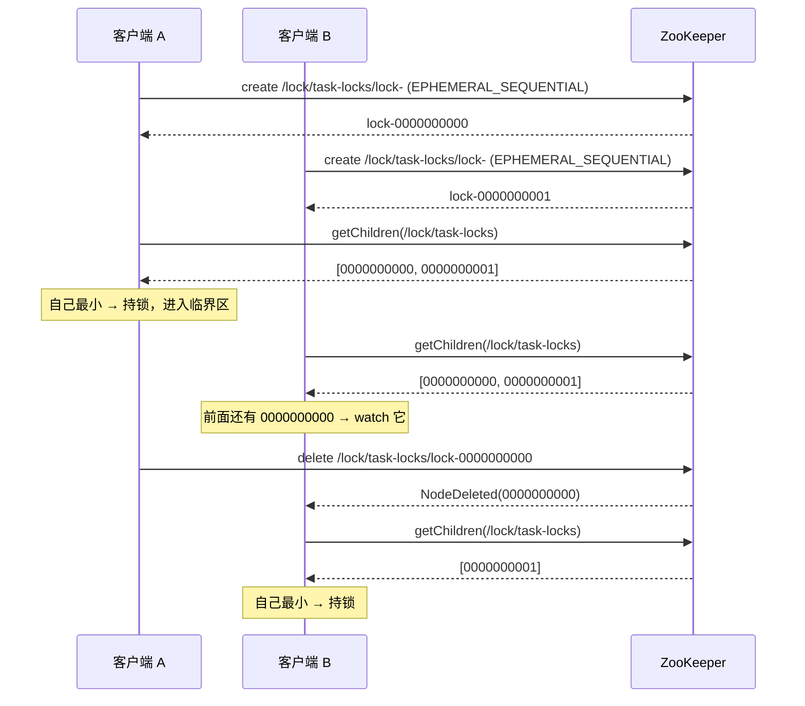

# 06 分布式锁：从超卖到临时顺序节点

> 这一章把「分布式锁」页签拆到底：为什么无锁会超卖、ZK 的锁算法为什么长这样、每一步日志对应哪行代码、实测数字怎么解释。

## 本章解决什么问题

单机锁（`synchronized`、`ReentrantLock`）只在**一个 JVM 进程内**有效。一旦服务部署多副本，两个进程各自持有自己的锁，同时进入临界区——锁就失效了。

本章回答：

1. 没有分布式锁时，「读-改-写」到底怎么丢数据？
2. 为什么锁节点必须是「临时 + 顺序」？
3. 为什么每个等待者只监听前一个节点？
4. 持锁者「假死」怎么办？

---

## 结论先行

| 问题 | 答案 |
| --- | --- |
| 丢失更新怎么发生 | 两个线程读到同一个旧值，各自 -1 后写回，后写的覆盖先写的 |
| ZK 锁的核心 | 在锁目录下创建**临时顺序节点**，序号最小的持有锁 |
| 为什么临时 | 会话结束自动删除，进程崩溃不会留下死锁 |
| 为什么顺序 | 先到先得，公平，且每个等待者能确定自己排第几 |
| 为什么只监听前驱 | 一次释放只唤醒一个人，避免羊群效应 |
| 最大的坑 | 持锁者 GC 停顿超过会话超时 → 锁被释放但业务还在跑 → 出现两个「持锁者」 |

---

## 1. 问题：库存扣减

临界区是一段「读-改-写」：

```java
int before = readStock();            // 读
Thread.sleep(10 + random(30));       // 模拟业务耗时
int after = before - 1;              // 改
writeStock(after);                   // 写
```

`src/main/java/com/example/learnzk/service/DistributedLockService.java:220-225`。

单线程下没问题。多线程下：

```
时间 →

线程 A：读 100 ────────────── 写 99
线程 B：    读 100 ────────────────── 写 99
线程 C：        读 100 ────────────────────── 写 99

三次扣减，最终库存 99 —— 丢了两次
```

三个线程都读到了 100，都认为「扣完是 99」，都写了 99。**后写的覆盖了先写的**，这就是丢失更新（lost update），在库存场景里等价于超卖。

### 1.1 为什么 sleep 是必要的

不加 `sleep` 时，一个线程的「读-改-写」可能在一个 CPU 时间片内完成，竞态窗口太小，实验现象不稳定。`sleep(10~40ms)` 把窗口放大，让并发冲突稳定复现。

这是**教学手段**，不是业务代码该有的写法。真实业务里的窗口来自网络 IO、数据库查询、RPC 调用——它们天然存在。

---

## 2. 为什么本地锁不够

```java
synchronized (this) { ... }
```

这把锁的对象在 JVM 堆里。两个服务实例有两个堆，两把锁互不相干：

```
实例 A：synchronized → 进入临界区
实例 B：synchronized → 也进入临界区     ← 锁形同虚设
```

要跨进程互斥，锁的状态必须放在一个**所有实例都能访问、且能保证一致性**的地方。ZooKeeper 正好提供了这个能力。

---

## 3. 方案一：抢一个 znode（能用，但不好）

最直觉的做法：

```
尝试 create /lock/my-lock（EPHEMERAL）
  成功 → 拿到锁
  失败（NODEEXISTS）→ 锁被别人持有，等一会儿再试
```

优点：简单。
缺点：三个明显问题。

| 问题 | 说明 |
| --- | --- |
| 不公平 | 谁先抢到看运气，可能有人一直抢不到（饿死） |
| 轮询浪费 | 没抢到只能 `sleep + retry`，延迟和 ZK 压力都高 |
| 惊群 | 如果改成 watch 这个节点，锁一释放，所有等待者同时被唤醒、同时抢 |

所以生产上的 ZK 锁基本都用下一种。

---

## 4. 方案二：临时顺序节点 + 监听前驱

这是 Curator `InterProcessMutex` 的算法，也是 ZK 分布式锁的标准答案。

### 4.1 五条规则

1. 在锁目录（如 `/learn-zk/lock/task-locks`）下创建一个**临时顺序节点**；
2. 取锁目录下所有子节点，按序号排序；
3. 如果自己的序号最小 → **持有锁**；
4. 否则找到**排在自己前面的那个节点**，只监听它；
5. 前一个节点被删除时被唤醒，回到第 2 步重新判断。

释放锁 = 删除自己的节点。

### 4.2 时序图



### 4.3 为什么三个设计缺一不可

| 设计 | 解决什么 | 去掉会怎样 |
| --- | --- | --- |
| **临时节点** | 持锁者崩溃后锁自动释放 | 进程 `kill -9` 后锁节点永远留在树上 → 死锁 |
| **顺序节点** | 先到先得，公平 | 所有人抢同一个名字，退化成方案一 |
| **只监听前驱** | 一次释放只唤醒一个人 | 所有等待者 watch 同一个节点 → 惊群 |

### 4.4 为什么不会「惊群」

假设 100 个等待者：

```
监听前驱：锁释放 → 只通知排第二的人 → 其余 99 人继续睡
监听锁节点：锁释放 → 通知全部 100 人 → 100 个请求同时打到 ZK
```

前者把「一次释放」的唤醒量控制在 O(1)，后者是 O(n)。

### 4.5 节点的实际样子

Curator 创建的节点名：

```
/learn-zk/lock/task-locks
├── _c_3f2a...-lock-0000000040   ← 序号最小，持锁者
├── _c_3f2a...-lock-0000000041   ← 监听 40
└── _c_3f2a...-lock-0000000042   ← 监听 41
```

`_c_<uuid>-` 前缀是 Curator 的 `withProtection()` 加的，用于「创建成功但响应丢失」时识别并清理重复节点。

**这带来一个排序陷阱**：直接按整个节点名排序，会先比较 uuid，顺序就乱了。必须只取最后 10 位序号排序——本项目 `describeQueue` 就是这么做的（`service/DistributedLockService.java:272-291`）。

---

## 5. 锁的释放：正常与异常

| 场景 | 发生什么 | 释放延迟 |
| --- | --- | --- |
| 正常 `release()` | 删除自己的临时节点 | 立即 |
| 正常停应用 | 容器关闭 → `CuratorFramework.close()` → 断开 | 立即 |
| 进程 `kill -9` | 连接断开，无通知 | 等 `sessionTimeout`（本项目 30s） |
| 网络分区 | 客户端以为还连着 | 服务端按超时清理；客户端可能仍以为自己持锁 |
| 机器断电 | 同 `kill -9` | 等 `sessionTimeout` |

这就是为什么会话超时不能设得太大：它直接决定「崩溃后锁多久能被别人拿到」。

---

## 6. 最大的坑：持锁者「假死」

### 6.1 场景

```
T0  客户端 A 拿到锁
T1  A 发生 Full GC / STW，暂停 35s
T2  服务端 30s 没收到心跳 → 判定会话过期 → 删除 A 的临时节点
T3  B 拿到锁，进入临界区
T4  A 的 GC 结束，继续执行临界区代码  ← 此时有两个「持锁者」
```

ZK 本身解决不了这个问题：它只能根据心跳判断生死，不能判断「进程还活着但暂停了」。

### 6.2 缓解手段

| 手段 | 做法 |
| --- | --- |
| 缩短临界区 | 锁内只做必要的读改写，不做慢 RPC |
| 调大 sessionTimeout | 容忍更长的 GC，但故障发现更慢（治标） |
| Fencing token | 见 6.3 |
| 业务幂等 | 即使重复执行，结果也正确（最终防线） |

### 6.3 Fencing token

思路：让锁带一个**单调递增的令牌**，被保护的系统拒绝旧令牌的写入。

```
A 拿到锁，令牌 = 40
A 暂停，锁被释放
B 拿到锁，令牌 = 41
A 恢复，带着令牌 40 去写 → 存储层发现 40 < 41，拒绝
```

ZK 里可以用锁节点的序号或 zxid 当令牌。注意：**令牌校验必须发生在被保护的数据侧**（数据库 `where version < ?`、对象存储的条件写），只在客户端校验没有意义。

本项目只演示锁的互斥，没有实现 fencing token——这是它作为教学工程的边界，生产使用要补上。

---

## 7. Curator `InterProcessMutex` 的额外能力

| 能力 | 说明 |
| --- | --- |
| 可重入 | 同一个线程重复 `acquire()` 会累加计数，需要相同次数的 `release()` |
| 超时获取 | `acquire(30, TimeUnit.SECONDS)`，超时返回 `false`，不会无限等 |
| 公平 | 按节点序号，先到先得 |
| 自动建锁目录 | 锁路径的父目录不存在时会自动创建 |
| 撤销 | `makeRevocable()` 允许外部请求释放锁（如管理员踢人） |

**可重入是按线程的**：Curator 内部记录「当前持有者线程 + 重入次数」。不同线程即使同属一个进程，也要重新排队。

---

## 8. 本项目的实验设计

### 8.1 参数

```java
int threads = clamp(r.threads() == null ? 8 : r.threads(), 1, MAX_THREADS);
int tasksPerThread = clamp(r.tasksPerThread() == null ? 5 : r.tasksPerThread(), 1, 200);
int initialStock = r.initialStock() == null ? 100 : Math.max(1, r.initialStock());
boolean useLock = r.useLock() == null || r.useLock();
```

`service/DistributedLockService.java:63-68`。

默认 8 线程 × 5 次 = 40 个扣减任务，初始库存 100。

### 8.2 让所有线程同时起跑

```java
CountDownLatch gate = new CountDownLatch(1);
...
gate.await();          // 所有工作线程在这里等
...
gate.countDown();      // 主线程放行，40 个任务同时开始
```

`service/DistributedLockService.java:99,105,121`。

如果不起跑线，线程池是逐个启动的，前面的任务可能已经做完，并发度上不去，实验就看不到冲突。

### 8.3 临界区

```java
held = mutex.acquire(LOCK_TIMEOUT_SECONDS, TimeUnit.SECONDS);   // :200
...
NodeInfo node = zk.read(stockPath);                             // :220
before = Integer.parseInt(node.data().trim());
Thread.sleep(10 + ThreadLocalRandom.current().nextInt(30));     // :223
after = before - 1;
zk.update(stockPath, String.valueOf(after), null);              // :225
...
mutex.release();                                                // :237
```

注意 `refresh`：`update` 传的 version 是 `null`，表示无条件写。**锁演示故意不用乐观锁**，否则 `BADVERSION` 会代替锁来防冲突，就看不出锁的作用了。

### 8.4 日志的五个阶段

每个任务固定输出：

| 日志 | 含义 |
| --- | --- |
| `开始抢锁` | 进入 `acquire` 前 |
| `拿到锁 等待=xx ms 当前队列=[...]` | 获取成功，附当时排队情况 |
| `扣减完成 库存 100 → 99 version=124` | 临界区结束 |
| `释放锁 持锁=xx ms 总耗时=xx ms` | `release` 完成 |
| `任务失败` / `抢锁超时` | 异常分支 |

完整日志写到 `logs/zk-lock-demo.log`（`logback-spring.xml:8-25`），页面「分布式锁」页签会自动加载。

### 8.5 结果核对

```java
int finalStock = readStock(stockPath);
int expectedStock = initialStock - totalTasks;
// 实际库存比期望高多少，就说明有多少次扣减被后写覆盖掉了
int lostUpdates = finalStock - expectedStock;
```

`service/DistributedLockService.java:129-132`。

符号方向要想清楚：

- 40 个任务应该让库存从 100 降到 60；
- 实际是 95，说明**只有 5 次扣减生效**；
- `95 - 60 = 35`，即 35 次扣减被覆盖。

### 8.6 一个容易误解的点

报告里的 `successCount` 是「任务没有抛异常」，不是「扣减生效」。无锁那一轮 40 个任务全部 `SUCCESS`，但其中 35 次写入被覆盖了。

---

## 9. 实测结果与解释

`POST /api/zk/lock/compare`，8 线程 × 5 任务，初始库存 100：

| 模式 | 期望库存 | 实际库存 | 丢失更新 | 耗时 |
| --- | --- | --- | --- | --- |
| 不加锁 | 60 | 95 | 35 | 199ms |
| 加锁 | 60 | 60 | 0 | 1629ms |

### 9.1 无锁为什么只剩 5 次生效

8 个线程几乎同时读到 100。`sleep` 让它们都停在「已经算完、还没写回」的窗口里，然后依次写 99。

只有当某个线程的读写恰好错开（比如它开始得晚，读到了别人写回的新值），扣减才会真正生效。40 次任务里大约只有个位数落在这种错开的位置。

这不是 bug，是**没有互斥时的正常结果**。换台机器，数字会变（94/34、96/36 都出现过），但「丢失」一定存在。

### 9.2 加锁为什么慢

因为临界区被串行化了：

```
40 个任务 × (10~40ms sleep + 2 次 ZK 读写 + 锁开销) ≈ 1.2~2s
```

无锁时 8 个线程并行，总耗时接近「最慢的一条任务链」；加锁后总耗时接近「所有任务耗时之和」。**用吞吐换正确性**，这是一切互斥方案的共同代价。

### 9.3 什么时候值得付这个代价

- 必须正确的写（库存、余额、配额）；
- 临界区短；
- 并发量不高（几十到几百 QPS 级别）。

如果临界区很长或并发很高，ZK 锁会成为瓶颈，应该考虑：

- 缩小锁粒度（按商品 ID 分锁，而不是全局一把锁）；
- 用数据库行锁 / 乐观锁；
- 用消息队列串行化。

---

## 10. 和 Redis 锁对比

| 维度 | ZooKeeper | Redis |
| --- | --- | --- |
| 一致性模型 | 过半写入，强一致 | 主从默认异步复制，故障切换可能丢锁 |
| 崩溃释放 | 会话超时（秒级） | TTL（毫秒~秒级） |
| 公平性 | 顺序节点，FIFO | 一般不保证 |
| 惊群 | 监听前驱，天然避免 | 需要额外设计 |
| 性能 | 较低（网络往返 + 过半） | 高 |
| 运维复杂度 | 需要维护 ZK 集群 | 通常已有 Redis |
| 适合 | 低频、强一致、需要公平 | 高频、可容忍极小概率失效 |

Redlock 算法在分布式系统领域有争议（依赖时钟假设），选型时要结合自己的故障模型，而不是只看「哪个快」。

---

## 11. 生产建议

1. **锁路径按资源分**：`/locks/stock/{skuId}`，不要用一把全局锁。
2. **一定要设获取超时**：`acquire(3, SECONDS)`，拿不到就快速失败，别把请求线程挂死。
3. **锁内不做慢操作**：RPC、发消息、写多张表都搬到锁外，或改成异步。
4. **临界区要幂等**：为会话超时导致的重复执行兜底。
5. **长临界区加 fencing token**：用锁节点序号做单调令牌，在数据侧校验。
6. **监控等待时间**：`acquire` 的耗时、锁目录的子节点数，都是容量信号。
7. **不要在 `SUSPENDED` 状态放锁**：会话可能还在，锁还在你手里。
8. **不要把 ZK 锁当分布式事务**：它只保证互斥，不保证多步操作的原子性。

---

## 12. 自检

1. 无锁时 40 个任务为什么最终只生效了 5 次？
2. 锁节点为什么必须同时是「临时」和「顺序」？
3. 只监听前驱，相比监听锁节点，避免了什么问题？
4. `successCount = 40` 但 `lostUpdates = 35`，矛盾吗？
5. 持锁者 Full GC 35 秒，会发生什么？怎么防？

参考：1、4.3、4.4、8.6、6。

---

## 13. 延伸阅读

- ZooKeeper 锁 recipe：<https://zookeeper.apache.org/doc/current/recipes.html#sc_recipes_Locks>
- Curator 分布式锁：<https://curator.apache.org/docs/>

下一篇：[`07-faq.md`](07-faq.md)
