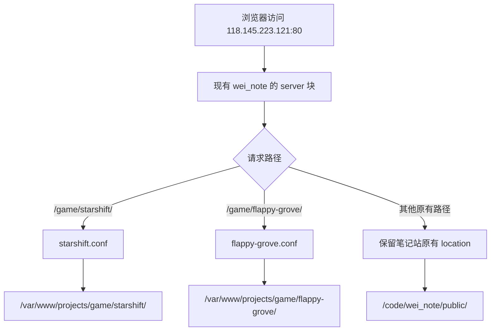

# Nginx 多项目子路径部署实战

2026-10-21，在已有 `wei_note` 笔记网站的 Ubuntu 服务器上，通过 Nginx 的独立 `location` 配置，先后上线星环跃迁和轻翼草甸。本文记录实际配置、选择原因、部署步骤、验证结果，以及下一次发布时可以复用的操作。

> [!info] 阅读范围
> 主线是已经完成的 HTTP 静态部署；后面的“新增项目”和“更新回滚”是基于本次结构整理的操作方法。本次没有配置域名、HTTPS、Docker 或后端进程。命令按用途重新整理，不是终端历史的逐行复制。笔记不保存登录密码、私钥等凭据。

相关入口：[[40_知识库/DevOps/DevOps MOC|DevOps MOC]]、[[Nginx 多前端项目部署]]、[[Nginx 反向代理与 HTTPS 配置]]。

## 一、最终部署效果

| 项目 | 访问地址 | 服务器文件目录 | 项目配置文件 |
| --- | --- | --- | --- |
| 原有笔记站 | [笔记站首页](http://118.145.223.121/) | `/code/wei_note/public/` | `/etc/nginx/sites-available/wei_note` |
| 星环跃迁 | [打开星环跃迁](http://118.145.223.121/game/starshift/) | `/var/www/projects/game/starshift/` | `/etc/nginx/project-locations/starshift.conf` |
| 轻翼草甸 | [打开轻翼草甸](http://118.145.223.121/game/flappy-grove/) | `/var/www/projects/game/flappy-grove/` | `/etc/nginx/project-locations/flappy-grove.conf` |

部署时的环境为 Ubuntu 24.04 LTS、Nginx 1.24.0；Nginx 已经安装、运行并监听公网 80 端口。两个游戏都由 Nginx 直接读取静态文件，服务器无需为了它们安装 Node.js、Unity 或数据库。

这里采用“分类前缀 + 项目名称”的路径约定：

```text
/game/starshift/
/game/flappy-grove/
/game/后续游戏名称/
```

本次只建立了两个游戏的具体入口，没有额外建设 `/game/` 游戏列表页。

## 二、整体请求如何流转



两个游戏仍然使用同一个 IP、同一个端口、同一个 `server` 块，各自的文件目录和路径配置独立。这里的“独立”是配置与目录的组织方式，不构成浏览器安全隔离：同协议、同主机、同端口的页面仍然属于同源。

关键改动只有两类：

1. 在原站点 `server` 中加入一次公共 `include`。
2. 每个游戏单独添加一个文件目录和一个 `location` 配置文件。

## 三、连接服务器前先确认公网入口

最开始提供的 `172.31.0.2` 是内网地址，从当前电脑连接其 22 端口超时；换成公网 IP `118.145.223.121` 后，SSH 登录成功。

本地电脑执行：

```bash
ssh -o ConnectTimeout=10 root@118.145.223.121
```

登录密码通过 SSH 提示交互输入。连接超时发生在认证之前，不能据此判断用户名或密码错误。遇到内网 IP，需要先确认 VPN、堡垒机或其他内网访问路径。

本文后续命令会标明在“本地电脑”还是“服务器”执行。两个终端的路径不要混用：本地项目在 `/Volumes/zhitai/game/`，服务器网页目录在 `/var/www/projects/`。

## 四、先检查已有服务，再决定如何接入

在服务器执行以下检查：

```bash
cat /etc/os-release
df -h /
command -v nginx
nginx -v
ss -lntp
systemctl is-active nginx
nginx -t
nginx -T
readlink -f /etc/nginx/sites-enabled/wei_note
curl -sS -I --max-time 10 http://127.0.0.1/
```

检查目的如下：

| 检查 | 要确认的内容 | 本次发现 |
| --- | --- | --- |
| `ss -lntp` | 谁占用了 80 端口 | 现有 Nginx |
| `systemctl is-active nginx` | 服务是否运行 | `active` |
| `nginx -T` | 主配置最终加载了哪些文件 | 已加载 `sites-enabled/wei_note` |
| `readlink -f` | 启用站点实际指向哪里 | `sites-available/wei_note` |
| 首页 HTTP 检查 | 原站点是否正常 | `200 OK` |
| 文件目录检查 | 原站点内容位于哪里 | `/code/wei_note/public/` |

因此本次不需要安装另一套 Nginx，也不需要新建一个抢占现有入口的默认站点。应在已经承载流量的 `server` 块中加入游戏路径。

`nginx -t` 检查配置语法以及配置引用文件的可打开性；`nginx -T` 还会输出配置内容。它们都不能替代网页、资源和游戏实际运行的检查。[官方命令参数说明](https://nginx.org/en/docs/switches.html)

## 五、修改之前保存配置和首页基线

在服务器上建立只有 root 可访问的工作目录，保存完整 Nginx 配置，以及原站点首页的响应内容：

```bash
deploy_backup=$(mktemp -d /root/nginx-deploy.XXXXXX)
cp -a /etc/nginx "$deploy_backup/nginx.before"

curl -fsS --max-time 10 http://127.0.0.1/ \
  -o "$deploy_backup/existing-site.before.html"

sha256sum "$deploy_backup/existing-site.before.html"
```

第二个游戏上线前，还额外保存了已经上线的星环跃迁页面，用于发布后逐字节比较：

```bash
curl -fsS --max-time 10 http://127.0.0.1/game/starshift/ \
  -o "$deploy_backup/starshift.before.html"
```

实际保留的部署工作目录如下：

| 部署批次 | 服务器工作目录 | `nginx.before/` 保存的状态 |
| --- | --- | --- |
| 星环跃迁 | `/root/starshift-deploy.XxbDQh/` | 尚未加入游戏路径的原站点配置 |
| 轻翼草甸 | `/root/flappy-grove-deploy.k7gwSw/` | 已经包含星环跃迁的配置 |

这两个备份对应不同时间点。需要恢复配置时，应选择正确批次并核对差异；恢复第一份完整快照会同时影响后来加入的公共入口和其他游戏配置。

## 六、统一文件目录与配置目录

部署后的主要结构为：

```text
/etc/nginx/
├── nginx.conf
├── mime.types
├── sites-available/
│   └── wei_note
├── sites-enabled/
│   └── wei_note -> /etc/nginx/sites-available/wei_note
└── project-locations/
    ├── starshift.conf
    └── flappy-grove.conf

/code/wei_note/public/
└── 原有笔记站的构建结果

/var/www/projects/game/
├── starshift/
│   └── index.html
└── flappy-grove/
    ├── index.html
    └── Build/
        ├── WebGL.loader.js
        ├── WebGL.framework.js
        ├── WebGL.data
        └── WebGL.wasm
```

初始化目录的服务器命令：

```bash
install -d -m 755 /etc/nginx/project-locations
install -d -m 755 /var/www/projects
install -d -m 755 /var/www/projects/game
```

本次文件由 root 管理，目录权限为 `755`，网页及资源文件权限为 `644`，Nginx worker 使用 `www-data` 用户读取文件。读取文件既需要文件的读权限，也需要每一级父目录的遍历权限，无需设置为 `777`。

## 七、主站点只增加一个公共 include

服务器的 `/etc/nginx/nginx.conf` 在 `http` 中原本就有：

```nginx
include /etc/nginx/mime.types;
default_type application/octet-stream;

include /etc/nginx/conf.d/*.conf;
include /etc/nginx/sites-enabled/*;
```

本次在 `/etc/nginx/sites-available/wei_note` 的 `server` 中新增：

```nginx
include /etc/nginx/project-locations/*.conf;
```

部署后的站点配置如下，保留原站点已有的首页、自动补 `.html`、错误页面和资源缓存规则：

```nginx
server {
    listen 80;
    server_name _;

    # 本次新增：每个项目各维护一份路径配置。
    include /etc/nginx/project-locations/*.conf;

    root /code/wei_note/public;
    index index.html;

    # 以下为原有笔记站规则。
    location / {
        try_files $uri $uri.html $uri/ =404;
    }

    location ~ ^/([^/]+)$ {
        try_files $uri $uri.html $uri/index.html =404;
    }

    error_page 404 /404.html;

    location ~* \.(css|js|png|jpg|jpeg|gif|ico|svg|woff|woff2|ttf|eot)$ {
        expires 1y;
        add_header Cache-Control "public, immutable";
    }
}
```

`project-locations/*.conf` 文件里放的是 `location`，所以必须由 `server` 上下文加载。直接把这些文件放入由 `http` 加载的 `/etc/nginx/conf.d/`，会出现 `location directive is not allowed here` 一类错误。

`server_name _;` 在这里沿用原配置；`_` 本身不是通配符，也不会自动赋予该站点 `default_server` 身份。以后增加其他 `server` 时，需要重新确认 `listen` 的默认站点和主机名匹配关系。

## 八、两个游戏的完整 Nginx 配置

### 8.1 星环跃迁

文件：`/etc/nginx/project-locations/starshift.conf`。

```nginx
location = /game/starshift {
    return 308 /game/starshift/$is_args$args;
}

location ^~ /game/starshift/ {
    root /var/www/projects;
    index index.html;
    autoindex off;
    try_files $uri $uri/ =404;
    add_header Cache-Control "no-cache";
}
```

### 8.2 轻翼草甸

文件：`/etc/nginx/project-locations/flappy-grove.conf`。

```nginx
location = /game/flappy-grove {
    return 308 /game/flappy-grove/$is_args$args;
}

location ^~ /game/flappy-grove/ {
    root /var/www/projects;
    index index.html;
    autoindex off;
    try_files $uri $uri/ =404;
    add_header Cache-Control "no-cache";
    add_header X-Content-Type-Options "nosniff";
}
```

### 8.3 为什么这里使用 root

本次目录与 URL 前缀一一对应，`root` 加请求 URI 就能找到文件：

```text
root                       请求 URI
/var/www/projects     +     /game/starshift/index.html
                     ↓
/var/www/projects/game/starshift/index.html
```

如果写成 `root /var/www/projects/game/starshift;`，再请求 `/game/starshift/index.html`，路径就会重复拼上 `/game/starshift/`，导致找错位置。

需要把 URL 前缀替换成另一段目录时，可以使用 `alias`。因此，路径部署不要求必须使用 `alias`，应按文件布局选择。[官方 root 与 alias 说明](https://nginx.org/en/docs/http/ngx_http_core_module.html#root)

### 8.4 为什么路径前面加 ^~

原站点存在匹配 `.js`、图片、字体等扩展名的正则 `location`。游戏的 `^~` 前缀成为最长前缀匹配时，Nginx 不再用这些正则接管请求；否则轻翼草甸的 JS 可能被交给笔记站目录和缓存规则处理。[官方 location 匹配规则](https://nginx.org/en/docs/http/ngx_http_core_module.html#location)

这既关系到资源能否正确找到，也关系到游戏是否会意外继承原站点一年的资源缓存策略。

### 8.5 为什么要补末尾斜杠

轻翼草甸入口使用相对地址：

```javascript
script.src = 'Build/WebGL.loader.js';
```

页面地址是 `/game/flappy-grove/` 时，资源解析为 `/game/flappy-grove/Build/WebGL.loader.js`；页面地址缺少最后的 `/` 时，浏览器会把最后一段当作文件名，可能解析成 `/game/Build/WebGL.loader.js`。

因此单独用精确匹配把无斜杠入口重定向为目录形式：

```nginx
return 308 /game/flappy-grove/$is_args$args;
```

`$is_args$args` 用于保留查询参数。例如 `/game/flappy-grove?from=note` 会跳转到 `/game/flappy-grove/?from=note`。[官方 return 指令说明](https://nginx.org/en/docs/http/ngx_http_rewrite_module.html#return)

### 8.6 try_files、index 与真正的 404

`try_files $uri $uri/ =404;` 按顺序检查文件、目录，均不存在时返回 404；目录首页由 `index index.html;` 处理。[官方 try_files 说明](https://nginx.org/en/docs/http/ngx_http_core_module.html#try_files)

两个游戏没有需要服务器兜底的 history 路由，所以不把缺失文件回退到入口 HTML。否则缺失的 `.js` 或 `.wasm` 可能得到 HTML 内容，让加载器报出更难理解的解析错误。

本次仍继承原站点的 `error_page 404 /404.html;`，所以不存在的游戏资源可能显示笔记站的错误页面；验证时应看 HTTP 状态码确实为 `404`。不同项目专属错误页可以后续另行配置。

### 8.7 为什么设置 no-cache

星环跃迁每次发布都叫 `index.html`；轻翼草甸的引擎资源也使用 `WebGL.wasm` 等固定文件名。先采用 `Cache-Control: no-cache`，让浏览器复用缓存前进行验证，减少更新后继续使用旧版本资源的情况。`no-cache` 允许存储并要求重新验证；完全不保存响应是 `no-store` 的语义。[RFC 9111 缓存指令](https://www.rfc-editor.org/rfc/rfc9111.html#section-5.2.2.4)

这里的 `add_header` 未加 `always`，不会保证在 404 等所有状态下都出现；自定义错误页的内部跳转也可能改变最终生效的头部配置。轻翼草甸另外设置 `nosniff`，要求浏览器遵守响应的内容类型。[官方 add_header 说明](https://nginx.org/en/docs/http/ngx_http_headers_module.html#add_header)

## 九、星环跃迁的构建与上传

### 9.1 本地构建

本地电脑执行：

```bash
cd /Volumes/zhitai/game/starshift
npm run build
npm test
shasum -a 256 dist/index.html
```

本次重新构建后，60 项测试全部通过。Vite 构建结果经项目脚本合并成独立 HTML，代码和样式全部内嵌，最终只需上传 `dist/index.html`，文件大小为 `63,035` 字节。

本次发布的 SHA-256：

```text
32d6190949235b99ece7ae47864b76daad1a156235eb338b18ffdcdf698b6c8f
```

### 9.2 上传到暂存目录，再安装到网站目录

本次先用 SCP 上传到 `/root/starshift-deploy.XxbDQh/`，校验摘要，再以 `644` 权限安装到正式网页目录。下面是等价的手动操作，暂存文件名经过简化。

本地电脑：

```bash
scp dist/index.html root@118.145.223.121:/root/starshift-index.html.new
```

服务器：

```bash
install -d -m 755 /var/www/projects/game/starshift
sha256sum /root/starshift-index.html.new

install -m 644 /root/starshift-index.html.new \
  /var/www/projects/game/starshift/index.html.new

mv /var/www/projects/game/starshift/index.html.new \
  /var/www/projects/game/starshift/index.html
```

以上安装命令用于首次上线。已经有线上版本时，应先按“更新与回滚”保存旧文件，再替换正式文件。

## 十、轻翼草甸的 WebGL 发布

### 10.1 本次使用已有的 WebGL 导出

本地项目：`/Volumes/zhitai/game/flappy-grove/`。

发布目录：`Unity/Builds/WebGL/`。

这次使用已有、已经过项目验证的 Unity WebGL 导出，未重新构建 Unity。部署前又检查了资源引用和文件完整性、JS 语法，以及 `WebAssembly.validate` 是否通过。

需要重新导出时，可在具备 Unity 编辑器及 Web Build Support 的本地环境执行：

```bash
cd /Volumes/zhitai/game/flappy-grove
npm run build
```

完整发布包含以下 5 个文件，总计 `18,775,358` 字节：

| 文件 | 大小（字节） | 正确的 HTTP Content-Type |
| --- | --- | --- |
| `index.html` | 3,151 | `text/html` |
| `Build/WebGL.loader.js` | 27,914 | `application/javascript` |
| `Build/WebGL.framework.js` | 309,682 | `application/javascript` |
| `Build/WebGL.data` | 5,310,794 | `application/octet-stream` |
| `Build/WebGL.wasm` | 13,123,817 | `application/wasm` |

### 10.2 为什么没有额外配置压缩头

本项目导出时关闭了 Unity 构建压缩，发布的是原始 `.js`、`.data`、`.wasm`。服务器已有 `mime.types` 提供 `application/wasm`，所以直接静态托管即可。

本次没有增加 `Content-Encoding: gzip`、`Content-Encoding: br` 或跨域隔离响应头。以后若更改 Unity 构建压缩或线程选项，应以新产物要求重新检查服务器响应配置；不要把这里的设置直接套用到另一种构建产物。

### 10.3 整体上传并校验每个文件

本次将 5 个文件打成约 `6.56 MB` 的 gzip tar 包，同时上传 `manifest.sha256`。服务器解压到临时目录，校验成功后，才把整个目录移动到正式位置。

以下是可复用的打包方法，在本地电脑执行：

```bash
cd /Volumes/zhitai/game/flappy-grove

python3 - <<'PY'
from pathlib import Path
import hashlib
import tarfile

root = Path('Unity/Builds/WebGL')
files = sorted(
    p for p in root.rglob('*')
    if p.is_file()
    and not any(part.startswith('.') for part in p.relative_to(root).parts)
)

manifest = ''.join(
    f'{hashlib.sha256(p.read_bytes()).hexdigest()}  {p.relative_to(root).as_posix()}\n'
    for p in files
)
Path('/tmp/flappy-grove-manifest.sha256').write_text(manifest)

with tarfile.open('/tmp/flappy-grove-webgl.tar.gz', 'w:gz') as archive:
    for p in files:
        archive.add(p, arcname=p.relative_to(root).as_posix(), recursive=False)
PY

scp /tmp/flappy-grove-webgl.tar.gz /tmp/flappy-grove-manifest.sha256 \
  root@118.145.223.121:/root/
```

首次上线时，服务器可以这样解包和安装；后续更新需另走版本切换流程：

```bash
bash -eu <<'SH'
test ! -e /var/www/projects/game/flappy-grove
release_dir=$(mktemp -d /var/www/projects/game/.flappy-grove.XXXXXX)

tar -xzf /root/flappy-grove-webgl.tar.gz \
  -C "$release_dir" --no-same-owner

(
  cd "$release_dir"
  sha256sum -c /root/flappy-grove-manifest.sha256
)

find "$release_dir" -type d -exec chmod 755 {} +
find "$release_dir" -type f -exec chmod 644 {} +

mv "$release_dir" /var/www/projects/game/flappy-grove
SH
```

本次五个文件的服务器摘要校验全部通过；随后还从公网下载五个文件，再次验证摘要与本地一致。网页能返回 200，并不意味着 WebGL 的大文件已经正确上传，所以资源校验不能只检查入口 HTML。

## 十一、检查配置后热重载

游戏文件和对应 `.conf` 安装好之后，在服务器执行：

```bash
nginx -t && systemctl reload nginx
systemctl is-active nginx
```

本次结果为配置检查成功、服务 `active`。这里使用 reload，平滑加载新配置。配置检查失败时，`&&` 会阻止后面的重载。[官方 Nginx 进程控制说明](https://nginx.org/en/docs/control.html)

这次不是重新创建 `sites-enabled` 链接：`wei_note` 站点已经启用，新增项目文件通过公共 `include` 加载即可。

> [!note] 重载成功之后仍然要访问验证
> 轻翼草甸发布后紧接着的一次本机探测曾返回 404，后续本机和公网检查均恢复为 200。现有记录不足以唯一确定该次 404 的原因，可能涉及新旧 worker 切换时机。应结合有界重试、实际配置、路径权限与日志判断，不能只凭 `reload` 返回成功就认定发布完成，也不应因为一次即时探测失败而盲目覆盖配置。

## 十二、验证方法和本次结果

### 12.1 公网入口和响应头

在本地电脑执行：

```bash
curl -sS -I http://118.145.223.121/
curl -sS -I http://118.145.223.121/game/starshift/
curl -sS -I http://118.145.223.121/game/flappy-grove/
curl -sS -I http://118.145.223.121/game/flappy-grove/Build/WebGL.wasm

curl -sS -D - -o /dev/null \
  'http://118.145.223.121/game/flappy-grove?probe=deploy'

curl -sS -D - -o /dev/null \
  http://118.145.223.121/game/flappy-grove/Build/missing.js
```

本次已经验证：

| 检查项 | 结果 |
| --- | --- |
| 原笔记站首页 | `200`，响应摘要与部署前一致 |
| 星环跃迁首页和 `index.html` | `200`，与本地产物摘要一致 |
| 轻翼草甸全部 5 个文件 | `200`，与本地各文件摘要一致 |
| `.wasm` 响应类型 | `application/wasm` |
| 不带末尾斜杠的游戏入口 | `308`，跳转到带斜杠的目录入口 |
| 入口带查询参数 | 参数在重定向后保留 |
| 缺失的游戏资源 | `404` |
| 游戏文件缓存头 | 正常资源响应为 `Cache-Control: no-cache` |
| 新增轻翼草甸后再次检查星环跃迁 | 首页内容与新增前一致 |

### 12.2 比较旧站内容，而不只看状态码

服务器执行：

```bash
curl -fsS --max-time 10 http://127.0.0.1/ \
  -o "$deploy_backup/existing-site.after.html"

cmp "$deploy_backup/existing-site.before.html" \
  "$deploy_backup/existing-site.after.html"
```

`cmp` 无输出且退出码为 0，表示两个文件内容一致。本次还对星环跃迁做了同样的比较。

`deploy_backup` 是第五节创建的目录变量。如果换了 SSH 会话，需要重新设置为对应的实际备份目录。

### 12.3 浏览器验证

星环跃迁已经在实际浏览器中验证页面渲染和开始游戏；轻翼草甸已经验证 WebGL 加载与渲染、空格起飞、P 暂停，以及 R 回到准备状态。

这些是本次部署后的桌面浏览器验证，不能据此扩展成所有手机和浏览器的实机兼容性结论。

星环跃迁上线页面：

![[40_知识库/DevOps/Nginx/images/星环跃迁-部署验证-20261021.png|800]]

轻翼草甸上线页面：

![[40_知识库/DevOps/Nginx/images/轻翼草甸-部署验证-20261021.png|800]]

## 十三、下一次新增一个游戏

假设新增游戏的名称是 `example`，约定如下：

| 内容 | 位置 |
| --- | --- |
| 访问路径 | `/game/example/` |
| 网页目录 | `/var/www/projects/game/example/` |
| 路径配置 | `/etc/nginx/project-locations/example.conf` |

`example.conf` 的基础模板：

```nginx
location = /game/example {
    return 308 /game/example/$is_args$args;
}

location ^~ /game/example/ {
    root /var/www/projects;
    index index.html;
    autoindex off;
    try_files $uri $uri/ =404;
    add_header Cache-Control "no-cache";
}
```

按以下顺序执行：

1. 确认游戏产物支持子路径，资源引用没有错误地指向根目录 `/assets/` 等位置。
2. 在本地完成该项目需要的构建和验证。
3. 上传到暂存位置，校验文件摘要，再安装到正式目录。
4. 写入独立的 `example.conf`；不需要再次向主站点添加公共 include。
5. 执行 `nginx -t && systemctl reload nginx`。
6. 验证入口、重定向、全部关键资源，以及原网站和其他游戏。

如果新项目是使用 history 路由的 SPA，应另行设计该项目自己的 HTML fallback，并让缺失静态资源仍返回 404；不能把本次游戏的规则原样套用到所有前端应用。

### 后续有后端服务时如何扩展

以下为扩展示例，本次服务器没有添加这条规则：

```nginx
location ^~ /api/example/ {
    proxy_pass http://127.0.0.1:3001/;
    proxy_set_header Host $host;
    proxy_set_header X-Real-IP $remote_addr;
    proxy_set_header X-Forwarded-For $proxy_add_x_forwarded_for;
    proxy_set_header X-Forwarded-Proto $scheme;
}
```

在这个普通前缀匹配示例中，`/api/example/users` 会转发为后端的 `/users`；如果 `proxy_pass` 写成不含尾部 URI 的 `http://127.0.0.1:3001`，则保留原请求路径。应先确定后端期望的路由，再选择写法。[官方 proxy_pass URI 处理规则](https://nginx.org/en/docs/http/ngx_http_proxy_module.html#proxy_pass)

## 十四、更新与回滚

### 14.1 单文件游戏更新

星环跃迁只有一个 HTML，适合“备份旧文件 → 写入 `.new` → 同目录重命名”。先从本地上传新文件到 `/root/starshift-index.html.new`，校验摘要后，在服务器执行：

```bash
bash -eu <<'SH'
game_dir=/var/www/projects/game/starshift
release_backup=$(mktemp -d /root/starshift-release.XXXXXX)
cp -a "$game_dir/index.html" "$release_backup/index.html.before"

install -m 644 /root/starshift-index.html.new "$game_dir/index.html.new"
mv "$game_dir/index.html.new" "$game_dir/index.html"

printf '旧版本备份目录：%s\n' "$release_backup"
SH
```

同一文件系统中的文件重命名让读者看到旧文件或新文件，避免直接上传时读取到半个文件。只更新静态文件，不需要重载 Nginx。

若需回滚，找到这次输出的备份目录，把旧 HTML 安装为 `index.html.rollback`，再重命名回 `index.html`，然后重新访问验证。

### 14.2 WebGL 多文件更新

轻翼草甸的 HTML、JS、data、wasm 应视为同一发布版本。不要边上传边逐个覆盖线上文件，否则浏览器可能混用不同版本。

本次上线的正式路径是一个真实目录，尚未采用版本目录加符号链接的发布机制。后续更新可先完整准备新目录并校验，再安排目录切换、保留旧目录回滚；两次目录重命名不是一次原子切换，期间可能有短暂的访问窗口。

如需更平滑的后续发布，可另行迁移到版本目录和符号链接结构。迁移前需先处理当前真实目录，不能直接用 `ln -sfn` 假设它已经是符号链接。即使目录指针切换是原子的，浏览器分多次请求固定文件名仍可能跨版本，进一步优化应考虑版本化资源 URL 和旧资源保留。

### 14.3 只下线某一个游戏

移出它自己的配置文件，原文件和公共 include 可以保留。下面以轻翼草甸为例，属于按需操作，并非本次已经执行的步骤：

```bash
bash -eu <<'SH'
disabled_dir=$(mktemp -d /root/nginx-disabled.XXXXXX)
config_file=/etc/nginx/project-locations/flappy-grove.conf
mv "$config_file" "$disabled_dir/"

if nginx -t && systemctl reload nginx; then
    printf '配置已移出，保存在：%s\n' "$disabled_dir"
else
    mv "$disabled_dir/flappy-grove.conf" "$config_file"
    nginx -t && systemctl reload nginx
    exit 1
fi
SH
```

恢复时把文件放回 `project-locations/`，配置检查成功后再重载。不要把文件仅改名为 `flappy-grove.disabled.conf` 留在原目录，因为它仍然匹配 `*.conf`，依旧会被加载。

## 十五、常见问题排查

| 现象 | 优先检查 |
| --- | --- |
| SSH 连接超时 | 公网地址、SSH 端口、网络路由、VPN 或堡垒机入口；尚未到密码验证阶段 |
| `location directive is not allowed here` | 项目片段是否被放到了 `http` 上下文，而不是实际站点的 `server` 中 |
| 游戏首页返回笔记站内容 | 项目 include 是否加载、请求落到了哪个 server/location |
| 首页正常但 JS 404 | 资源是否使用正确子路径，以及是否被旧站正则 location 接管 |
| 不带斜杠时无法加载 | 是否配置精确入口的 308 重定向 |
| root 路径看起来正确但仍 404 | 是否把 `/game/项目名/` 在 root 和 URI 中重复拼接 |
| WebGL 一直停在加载页 | loader、framework、data、wasm 是否齐全、摘要是否正确、响应类型是否匹配 |
| wasm 返回 HTML | 文件不存在时是否错误地回退到入口 HTML 或其他页面 |
| 更新后仍显示旧版 | 固定文件名缓存、是否命中原站点的一年缓存规则，以及实际返回的文件摘要 |
| 返回 403 | `namei -l` 检查全部父目录的遍历权限和文件读权限 |
| 配置检查通过但访问失败 | 检查服务实际状态、错误日志、活动配置和公网请求；语法正确不代表发布成功 |

服务器上的排查命令：

```bash
nginx -T
systemctl status nginx --no-pager
namei -l /var/www/projects/game/flappy-grove/index.html
tail -n 50 /var/log/nginx/error.log
tail -n 50 /var/log/nginx/access.log
```

## 十六、本次记录与参考资料

本次本地项目记录分别位于：

```text
/Volumes/zhitai/game/starshift/deploy/README.md
/Volumes/zhitai/game/starshift/deploy/nginx/starshift.location.conf
/Volumes/zhitai/game/starshift/evidence/deployment-20261021.png

/Volumes/zhitai/game/flappy-grove/deploy/README.md
/Volumes/zhitai/game/flappy-grove/deploy/nginx/flappy-grove.location.conf
/Volumes/zhitai/game/flappy-grove/deploy/manifest.sha256
/Volumes/zhitai/game/flappy-grove/evidence/deployment-20261021.json
/Volumes/zhitai/game/flappy-grove/evidence/deployment-20261021.png
```

本笔记中的截图已经复制到知识库附件目录，阅读时不依赖原项目仍在本机同一位置。以上路径作为部署记录的来源索引。

- [[40_知识库/DevOps/DevOps MOC|DevOps MOC]]
- [[Nginx 多前端项目部署]]
- [[Nginx 反向代理与 HTTPS 配置]]
- [[前后端项目部署方案详解]]
- [Nginx 命令参数](https://nginx.org/en/docs/switches.html)
- [Nginx 进程控制与重载](https://nginx.org/en/docs/control.html)
- [Nginx 核心模块：location、root、alias、try_files](https://nginx.org/en/docs/http/ngx_http_core_module.html)
- [Nginx return 指令](https://nginx.org/en/docs/http/ngx_http_rewrite_module.html#return)
- [Nginx add_header 指令](https://nginx.org/en/docs/http/ngx_http_headers_module.html#add_header)
- [Nginx proxy_pass 指令](https://nginx.org/en/docs/http/ngx_http_proxy_module.html#proxy_pass)
- [RFC 9111：HTTP 缓存与 no-cache](https://www.rfc-editor.org/rfc/rfc9111.html#section-5.2.2.4)
