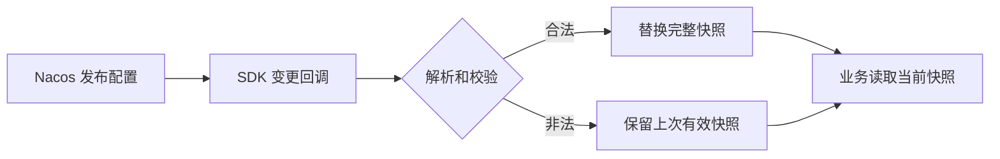

# Java 两篇分享快速上手

这份文档给准备分享的你使用：**先跑出结果，再顺着代码解释原因，最后练习讲给别人听。** 两篇仍然独立准备、独立演示，可以先学任意一篇。

建议用约 60 分钟完成第一次学习：全局认识 5 分钟、配置中心 20 分钟、定时任务 25 分钟、自测复述 10 分钟。首次下载镜像和构建时间另算；这轮学习帮助你建立主线，正式分享前还需要按详稿彩排。

## 先记住这两句话

| 分享 | 一句话理解 | 要证明的结果 |
| --- | --- | --- |
| 配置中心 Apollo / Nacos | 把会变化的业务参数集中发布，让运行中的应用收到并安全使用新值 | 业务行为改变、应用未重启、其他环境不受影响 |
| ElasticJob 定时任务 | 到时间执行任务，并在多个实例之间分配工作；失败数据由业务设计补偿 | 两实例分担三分片，失败订单可补偿，重跑不重复记流水 |

前端类比只负责搭桥：配置中心从 `.env` 讲到运行时远程配置；定时任务从 `setInterval` 讲到多进程协调。讲完类比，要回到 Java 应用里真正执行的逻辑。

## 开始前：把案例跑起来

宿主机安装 Docker 和 Compose v2 即可，Java 与 Maven 都在容器里。先确认：

```bash
docker --version
docker compose version
```

两篇各有一个 `案例/`，**在准备学习的那一篇目录中**执行下面两条命令：

```bash
docker compose up -d --build
docker compose run --rm verify
```

`verify` 会校验实际行为并重置本篇演示数据，成功后退出。建议一次先启动一篇，为 Docker 分配至少 3 GB 内存。

| 案例目录（打开 README 查看完整说明） | 演示入口 |
| --- | --- |
| [配置中心案例](../20_项目/Java配置中心分享/案例/README.md) | [配置演示台](http://localhost:8081/) |
| [定时任务案例](../20_项目/Java定时任务分享/案例/README.md) | [任务演示台](http://localhost:8091/) |

公司电脑无法联网时，按 [[配置中心演示手册#离线迁移]] 或 [[ElasticJob演示手册#离线迁移]] 提前导入镜像。源码压缩包不包含镜像，镜像架构须匹配目标电脑。

## 第一篇：20 分钟学会配置中心的主线

### 1. 用前端经验理解它（约 4 分钟）

`.env` 适合解释“把参数从代码移出去”。常见前端构建工具会在构建时替换环境变量，因此修改后通常需要重新构建和发布。**运行时远程配置**更接近这里要讲的动态刷新：应用持续接收变化，并让业务读取新状态。

Apollo 可以类比为“集中管理和发布远程配置的平台”，feature flag 是其中一种业务用途。配置发布平台负责管理配置，客户端和业务代码负责让它生效。

| 必须认识的词 | 在本次分享中怎样理解 |
| --- | --- |
| 配置项 | `order.list.enabled` 控制列表开关，`order.list.page-size` 控制每页数量 |
| Nacos 配置定位 | Namespace + Group + Data ID；本例用 Namespace 区分开发、测试 |
| Apollo 配置定位 | 先确定 AppId、环境、Cluster、Namespace，再定位配置项 |
| 动态刷新 | 订阅变更 → 解析校验 → 替换内存快照 → 后续业务读取新值 |

Apollo 的 Namespace 常用于组织配置，Nacos 的 Namespace 在本例用于环境隔离，不能只按同名词一一对应。**当前可运行案例使用 Nacos，未部署 Apollo 服务端。** 更完整的类比见 [[Apollo与前端配置类比]]。

### 2. 按这五步亲手验证（约 7 分钟）

打开 [配置演示台](http://localhost:8081/)，每一步先预测结果，再操作。

| 操作 | 应看到什么 | 这一步讲什么 |
| --- | --- | --- |
| 点击“恢复初始配置” | 开发甲、乙：关闭 / 100；测试：关闭 / 7；列表返回 0 笔 | 同一份代码可以使用不同环境的配置 |
| 选择开发环境，开启列表，每页 3，点击“发布到 Nacos” | 两个开发实例变为开启 / 3，列表返回 3 笔 | 配置确实影响业务，而非只改变页面数字 |
| 对比启动标识和测试实例 | 两个开发实例启动标识不变，测试仍关闭 / 7 | 没重启，也没有串环境 |
| 在 Nacos 原生控制台把开发配置的 `page-size` 改为 0 并发布 | 演示台显示拒绝原因，业务继续使用上一次有效值 3 | 收到配置后仍要做业务校验 |
| 把 `page-size` 恢复为 2 并发布 | 错误清除，列表返回 2 笔 | 合法配置能恢复生效 |

原生控制台：[Nacos](http://localhost:8848/nacos/)。定位到 Namespace `share-dev` → Group `ORDER_SERVICE` → Data ID `order-list.yaml`。需要修改的内容结构如下：

```yaml
order:
  list:
    enabled: true
    page-size: 3
```

非法值必须在原生控制台发布，因为演示台自己的发布接口会提前校验。页面每两秒轮询只负责展示；后台刷新由 Nacos SDK 订阅驱动。

### 3. 只读这三个文件（约 6 分钟）

文件均在配置中心案例的 `src/main/java/cn/orbit/share/` 下，先按下面顺序读，不必从启动类开始。

| 顺序 | 文件与入口 | 只找这一件事 |
| --- | --- | --- |
| ① | [NacosConfigClient.java](../20_项目/Java配置中心分享/案例/src/main/java/cn/orbit/share/NacosConfigClient.java)：`start()` | 初次读取并注册监听，回调调用 `store.apply()` |
| ② | [ConfigStore.java](../20_项目/Java配置中心分享/案例/src/main/java/cn/orbit/share/ConfigStore.java)：`apply()`、`parse()` | 完整解析、校验，再替换快照；非法变更保留旧快照 |
| ③ | [ConfigController.java](../20_项目/Java配置中心分享/案例/src/main/java/cn/orbit/share/ConfigController.java)：`orders()` | 每次业务请求读取当前快照，用开关和页大小决定返回结果 |



快照是这段代码的重点：一次读取拿到同一组开关和页大小，避免读到一半新、一半旧的字段。它保证单进程中的完整替换，多个实例仍可能先后收到变更，不代表集群同时切换。

### 4. 不看稿，复述三分钟

> 订单列表已经上线，现在希望调整开关和每页数量。我们把它们放到配置中心，用环境、配置分组和文件名定位。应用启动时读取，运行时监听变更。收到新内容后先检查类型和范围，通过后替换完整快照，后续请求就读到新值。演示里开发环境从关闭变为开启、返回三条，启动标识没变，测试环境也没变。发布非法页大小时，应用记录错误并保留旧配置。最后把命名、类型、默认值、负责人和回滚方式写进规范。

能解释这段话后，再读 [[配置中心分享讲稿]] 的第 03～05、07 节补足细节，收尾材料用 [[配置中心命名规则]]。

## 第二篇：25 分钟学会定时任务的主线

### 1. 从定时器走到多实例（约 4 分钟）

浏览器的 `setInterval` 在当前页面反复执行回调。打开两个页面，就有两套定时器；类似地，两个 Java 实例各自运行普通本地定时任务，也可能各执行一遍业务。

ElasticJob 把“什么时候执行、哪些分片交给哪个实例”组织起来。**本例是一个逻辑任务、三个工作分片，由两个实例共同完成。** 它不是把整个任务固定在一个实例上，也不保证业务副作用天然只发生一次。

| 前端经验 | 对应到本例 |
| --- | --- |
| 定时触发回调 | Cron 到点调用 `SimpleJob.execute()` |
| 给回调传参数 | 公共参数 `pending`，分片参数 `华东 / 华南 / 华北` |
| 将数组按区域分组 | 业务查询按当前分片的区域筛选待补偿订单 |
| 点击“重试” | 手动触发后再次查询待补偿数据 |
| 按钮置灰防连点 | 只保护入口；业务幂等仍要靠数据库等机制保证 |

### 2. 先记住三个数，再跑三轮（约 8 分钟）

**12 笔订单、3 个分片、2 个实例。** 分片 `0=华东、1=华南、2=华北`，每个区域各 4 笔。具体哪个实例分到哪些片，以现场分配为准。

打开 [任务演示台](http://localhost:8091/)，点击“重置演示订单”，然后按表操作。每轮等运行分片回到 0、出现本轮完成记录后再核对结果。

| 阶段 | 成功订单 | 待补偿订单 | 业务流水 | 观察重点 |
| --- | --- | --- | --- | --- |
| 重置后 | 0 | 12 | 0 | 1005 的模拟故障已开启 |
| 第一次“触发一次任务” | 11 | 1 | 11 | 三个分片覆盖三个区域，1005 记录失败原因 |
| 点击“恢复模拟依赖”，再触发 | 12 | 0 | 12 | 1005 尝试 2 次，其余订单尝试 1 次 |
| 额外再触发一次 | 12 | 0 | 12 | 成功订单不再处理，没有新增流水 |

教学演示台调用真实 `JobOperateAPI.trigger()`，页面本身由案例提供。默认定时计划是北京时间每天零点，学习时直接手动触发，无需等到点。

### 3. 只读这四个文件（约 8 分钟）

文件位于定时任务案例的 `src/main/java/cn/orbit/share/`。先读业务入口，再回头看框架注册。

| 顺序 | 文件 | 只找这一件事 |
| --- | --- | --- |
| ① | [CompensationJob.java](../20_项目/Java定时任务分享/案例/src/main/java/cn/orbit/share/CompensationJob.java) | 实现 `SimpleJob`，从上下文拿分片编号、分片参数和公共参数 |
| ② | [CompensationService.java](../20_项目/Java定时任务分享/案例/src/main/java/cn/orbit/share/CompensationService.java) | 按区域查询待补偿订单，逐笔处理，汇总分片结果 |
| ③ | [OrderProcessor.java](../20_项目/Java定时任务分享/案例/src/main/java/cn/orbit/share/OrderProcessor.java) | 单笔事务、行锁、成功状态检查，以及同事务内写流水和改状态 |
| ④ | [JobInfrastructure.java](../20_项目/Java定时任务分享/案例/src/main/java/cn/orbit/share/JobInfrastructure.java) | 注册中心、Cron、三分片参数、任务注册与手动触发 API |


一定要分清两个责任：框架把“华南”参数交给代码，**业务代码必须自己按华南过滤数据**。框架不会自动替你加 SQL 条件。

### 4. 用三个问题检验理解（约 5 分钟）

**为什么第一次失败，11 笔成功订单没有跟着回滚？** 每笔订单在独立事务入口处理，成功的单笔事务已经提交。Job 最后汇总抛错，不能撤销之前已提交的事务。

**为什么重跑只处理 1005？** 重新触发整项任务，各分片重新查询“待补偿”订单；1005 仍满足条件，成功订单已不满足。这里不是框架自动回放上次的失败订单。

**为什么还需要幂等？** 待补偿查询缩小处理范围，行锁和事务内状态复核应对并发进入，流水表以订单 ID 唯一，并与订单状态在同一事务提交。本例保证的是同一个数据库内的处理约束；远程退款、发消息等副作用需要另外设计幂等键和一致性方案。

三分钟复述提纲：**两个本地定时器会各跑一遍 → 一个逻辑任务分三片 → 两实例按片分工 → 区域参数必须用于查询 → 首轮 11 成功 1 失败 → 恢复后查待补偿数据 → 额外重跑流水仍为 12 → 用单笔事务和幂等保护业务。**

继续补深度时，优先读 [[ElasticJob分享讲稿]] 的第 03、05、07、08 节；会后模板用 [[ElasticJob任务代码模板]]。

## 最后 10 分钟：把“看懂”变成“能讲”

分别关掉讲稿，给自己做一次简短复述：每篇约 3 分钟讲主线，剩余时间定位卡住的代码或概念。下面五项能完成，就可以进入完整彩排：

- [ ] 能独立操作配置演示，并用启动标识、业务响应和测试实例证明三个结果。
- [ ] 能画出“配置发布 → 监听 → 校验 → 快照 → 业务读取”，解释非法配置如何处理。
- [ ] 能解释三个分片为什么可以分给两个实例，参数如何决定数据范围。
- [ ] 能完成任务三轮演示，并说清为什么结果是 11 → 12 → 12。
- [ ] 能解释“重新触发”和“失败数据补偿”的关系，以及数据库幂等的适用边界。

第一次学习可以暂缓：配置协议内部细节、ZooKeeper 选举细节、源码逐行阅读和执行中宕机实验。本例关闭 `failover`、`misfire`，不会自动证明宕机接管或自动重试能力；先掌握本例确实演示的行为。

正式上台前，分别按 [[配置中心时长核查与彩排表]]、[[ElasticJob时长核查与彩排表]] 计时。两篇详稿各安排 **37 分钟主体 + 5 分钟问答**，实际口播时长以你的彩排为准。

## 掌握主线后再学的两个实验

2026-10-22 补充，分别安排，不增加第一次 60 分钟学习路径的必读量：

| 分享 | 接下来做什么 | 要能回答的问题 |
| --- | --- | --- |
| 配置中心 | [[配置中心扩展实验与实践]]：停掉 Nacos，再对比运行中、同容器重启、全新探针 | 为什么磁盘有缓存，当前案例重启仍失败？ |
| 定时任务 | [[ElasticJob扩展实验与实践]]：载入 750 笔订单，逐轮触发并核对 300、600、750 | 为什么框架本轮成功，业务仍可能存在积压？ |

每篇扩展实验约 8 分钟，主讲加上实验为 45 分钟，问答另留 5 分钟。资源刷新、用户灰度、DataflowJob、长耗时调度和历史日期补跑作为设计推演放在扩展文档中，未全部实现为演示功能。

## 卡住时只查这里

在对应的 `案例/` 目录执行：

```bash
docker compose ps -a
docker compose logs --tail 80 app-a app-b
```

配置初始化容器 `config-init` 显示 `Exited (0)` 是正常完成。端口冲突时按本篇 `.env.example` 调整；普通停止用 `docker compose down`。完整排查、离线迁移和备用接口见 [[配置中心演示手册]]、[[ElasticJob演示手册]]。
