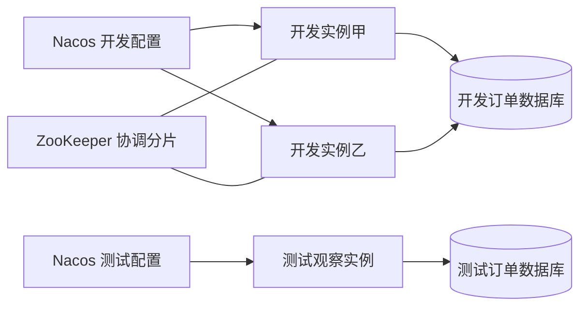
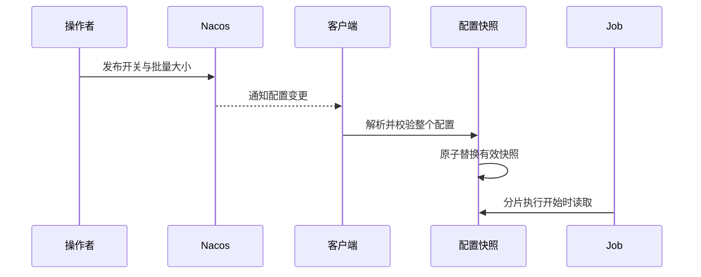

# 分享讲稿：让订单补偿任务可配置、可分片、可恢复

> [!info] 使用方式
> 听众有 Java 基础，总时长 30 分钟。下列“第几页”可直接作为幻灯片分页，每页同时提供讲述重点和演示动作。运行步骤见 [[演示操作手册]]，源码在本项目的 `案例/` 目录。

## 第 1 页：从一个订单补偿需求开始（2 分钟）

**页面内容**：三个问题——参数怎么调整、多个实例怎么分工、失败订单怎么补回来。

**讲述示例**：

“假设一批订单因为下游超时，需要后台定期补偿。业务希望能随时关闭补偿，或把每批 100 笔改成 20 笔。服务部署两份后，还要避免两份服务重复处理同一批订单。今天就围绕这项任务，串起配置中心和定时任务。”

“最后希望大家能独立加一个动态配置、写一个分片任务，并知道重跑之前应该检查什么。”



演示约定：12 笔订单分属华东、华南、华北；总分片数为 3，执行实例数为 2。订单 1005 会在第一次处理时模拟下游失败。

## 第 2 页：配置中心先解决“去哪里找配置”（2 分钟）

**页面内容**：配置定位的三个维度。

| 维度 | 本案例取值 | 用途 |
| --- | --- | --- |
| Namespace | `share-dev` / `share-test` | 区分开发与测试环境 |
| Group | `ORDER_SERVICE` | 组织订单服务的配置集 |
| Data ID | `order-service.yaml` | 指定具体配置集 |

“配置集里再放具体的配置项。应用读取的是某个命名空间、某个分组下的某份配置，不能只记住文件名。”

```yaml
order:
  compensation:
    enabled: false
    batch-size: 100
```

“两个环境可以使用相同的 Group、Data ID 和业务配置项名称，各自保存不同的值。开发环境发布不会修改测试环境的这份配置。”

Namespace 是逻辑资源隔离维度，实际项目还要配合权限和连接信息管理。配置模型依据：[Nacos 官方说明](https://www.nacos.io/docs/ebook/szf3gh/)。

## 第 3 页：配置发布后，业务值如何改变（2 分钟）

**页面内容**：发布、订阅、校验、替换、读取五个动作。



本案例使用原生 Nacos SDK，把刷新过程显式展示出来：

```java
// NacosConfigClient.java：订阅配置，回调里只负责交给配置仓库处理。
public void receiveConfigInfo(String configInfo) {
    store.apply(configInfo);
}
```

```java
// ConfigStore.java：校验成功后，一次性替换不可变快照。
Snapshot next = parse(content);
State old = state.get();
state.set(new State(next, old.refreshCount() + 1, ""));
```

“配置更新和业务采用新配置之间，要有明确的读取路径。这里使用 `AtomicReference` 替换整个快照，避免开关读到新版本、批量大小还停在旧版本。”

“每次分片调用开始时只取一次快照，这次调用使用同一份配置。不同实例的刷新存在传播时间，所以现场会等两个开发实例都显示新值后再触发任务。”

SDK 订阅能力依据：[Nacos Java SDK](https://nacos.io/docs/latest/manual/user/java-sdk/usage/)。

## 第 4 页：演示不重启刷新与环境隔离（4 分钟）

**页面内容**：修改前后对照。

| 观察项 | 发布前 | 发布开发环境后 |
| --- | --- | --- |
| 开发实例甲 | `false / 100` | `true / 20` |
| 开发实例乙 | `false / 100` | `true / 20` |
| 测试观察实例 | `false / 7` | `false / 7` |
| 两个开发实例启动标识 | 记录原值 | 保持原值 |

操作：打开演示台，先重置，再发布开发环境 `true / 20`。随后打开 Nacos 原生控制台，定位到同一配置，展示它确实已经保存。

**讲述示例**：

“这里同时看三个证据：业务接口读到了新值、配置版本发生了变化、应用启动标识没有变。测试实例仍然是 7，说明它订阅的是另一份环境配置。”

如果时间充足，可以直接在 Nacos 原生控制台把批量大小改成 10，再回演示台观察两个开发实例的刷新。

## 第 5 页：动态刷新需要定义边界（2 分钟）

**页面内容**：什么时候生效、哪些值可改、坏配置怎么办。

- 本案例开关在分片开始时读取；关闭后，后续分片调用会跳过，已经开始的一批继续执行。
- 批量大小必须是 1～1000 的整数。非法配置会被拒绝，接口显示错误，并继续使用上次有效快照。
- 端口、连接池、线程池等已初始化资源是否能刷新，要看相关组件的生命周期与重建能力。
- 布尔开关是简单 feature flag。按用户灰度、实验分组等能力还需要额外规则。

“Spring Cloud 项目也常用配置绑定和刷新作用域。今天的案例显式展示 SDK 和快照链路，实际接入时要核对团队的版本和绑定方式，不能认为放到配置中心就一定会更新业务对象。”

可参考 [Spring Cloud Alibaba 接入说明](https://sca.aliyun.com/en/docs/2025.x/user-guide/nacos/quick-start/)。本案例不依赖 Spring Cloud Alibaba，也不需要在 Job 上添加 `@RefreshScope`。

衔接：“参数已经可以调整，接下来看看多个实例如何一起执行这项任务。”

## 第 6 页：从前端轮询讲到多实例协调（1 分钟）

**页面内容**：先展示大家熟悉的订单列表轮询，`refreshOrders` 代表刷新列表的业务函数：

```javascript
setInterval(() => refreshOrders(), 5000);
```

**讲述示例**：

“前端页面定时刷新订单列表，可以注册一个定时器。打开两个标签页，每个页面都注册了自己的定时器，于是会分别发起请求。这个例子先帮助我们理解：独立运行的环境，各有自己的触发逻辑。”

“再把任务搬到 Node.js 服务，用 `node-schedule` 按时间执行。只要两个服务进程都注册了同一任务，就仍然需要考虑它们会不会处理相同数据。Java 服务部署两份时，也会遇到同一类协调问题。”

“ElasticJob 在调度之外增加分片协调：到时间了由谁执行、每个实例处理哪部分数据，都需要有安排。我们按三个区域分成三片，再交给两个实例分担。”

浏览器计时存在实际延迟，Node Schedule 定义的是进程内调度；两者可以帮助解释触发和生命周期，但不能直接类比成跨实例协调能力。依据：[MDN 定时器说明](https://developer.mozilla.org/en-US/docs/Web/API/Window/setInterval)、[Node Schedule 官方说明](https://github.com/node-schedule/node-schedule)。

总分片数为 1 时，正常调度由一个实例承担；总分片数为 3 时，可以由两个实例分担。分片协调不能替代业务幂等。依据：[ElasticJob 弹性调度](https://shardingsphere.apache.org/elasticjob/current/en/features/elastic/)。

## 第 7 页：一个最小 Job 长什么样（2 分钟）

先看 Node.js 中熟悉的写法，`compensateOrders` 代表补偿业务函数：

```javascript
import schedule from 'node-schedule';

// 每天本地时间零点触发，回调负责调用业务。
schedule.scheduleJob('0 0 * * *', () => compensateOrders());
```

“把回调函数的角色对应到 Java 的 `execute()`，就容易理解 Job 为什么只保留一个薄入口。业务处理仍交给 Service。”

| 熟悉的写法 | ElasticJob 对应位置 |
| --- | --- |
| 注册一个调度任务 | 创建 `JobConfiguration`，启动 `ScheduleJobBootstrap` |
| 任务名称或标识 | `jobName` |
| 定时规则 | `cron` 与时区 |
| 到时间调用的回调 | `SimpleJob.execute(context)` |
| 调用业务函数 | 调用业务 Service |

这段 JavaScript 只用于讲解，不是 Docker 案例的依赖。Node 示例使用五字段 Cron，Java 案例使用包含秒的六字段表达式，表达式不能直接照搬。

实际入口来自 `CompensationJob.java`，只做上下文转换和结果汇总：

```java
@Override
public void execute(ShardingContext context) {
    CompensationService.RunResult result = service.execute(
        context.getShardingItem(),
        context.getShardingParameter(),
        context.getJobParameter());
    if (result.failed() > 0) {
        throw new IllegalStateException("分片存在失败订单，请查看业务执行记录");
    }
}
```

任务定义来自 `JobInfrastructure.java`：

```java
JobConfiguration config = JobConfiguration.newBuilder("order-compensation-job", 3)
    .cron("0 0 0 * * ?")
    .timeZone("GMT+08:00")
    .shardingItemParameters("0=华东,1=华南,2=华北")
    .jobParameter("pending")
    .monitorExecution(true).failover(false).misfire(false)
    .jobErrorHandlerType("LOG").overwrite(true).build();
```

“任务定义回答何时触发、分几片、参数是什么。Job 入口把上下文交给 Service；按区域查询、处理订单和记录结果都由业务层完成。”

本案例以北京时间每天零点自动调度，现场使用手动触发。ElasticJob 3.0.4 的显式时区采用 `GMT+08:00` 格式。配置固定在代码中，因此示例设置 `overwrite=true`；实际团队若由控制台维护调度配置，需要统一配置权威来源。

接口与生命周期依据：[作业开发](https://shardingsphere.apache.org/elasticjob/current/en/user-manual/usage/job-api/job-interface/)、[Java API](https://shardingsphere.apache.org/elasticjob/current/en/user-manual/usage/job-api/java-api/)。代码使用固定的 ElasticJob **3.0.4**，该版本部分包名带有 `lite`。

## 第 8 页：分片编号和分片参数分别是什么（3 分钟）

| 名称 | 本例 | 解释 |
| --- | --- | --- |
| 总分片数 | `3` | 三个逻辑工作单元 |
| 当前分片号 | `0` / `1` / `2` | 本次调用负责哪个工作单元 |
| 当前分片参数 | 华东 / 华南 / 华北 | 业务用它确定处理范围 |
| 公共参数 | `pending` | 各分片共用，示例约定为处理待补偿订单 |

“分片不是线程数，也不等于机器数。两个实例可以承担三个分片，具体分配由框架协调，现场看实际结果。”

可以这样类比前端的数据分组处理：

```javascript
const regions = ['华东', '华南', '华北'];
const region = regions[shardIndex];
const currentOrders = orders.filter(order => order.region === region);
```

“数组里有三个工作单元，但不要求有三台机器。框架负责把工作单元分配给实例；业务代码还要像这里的 `filter` 一样，限定自己处理的范围。案例真正执行的是数据库查询，没有把订单搬到浏览器里处理。”

若听众提到 `Promise.all`，可以用它解释并行处理多个工作单元；跨进程的分配与协调还需要框架和注册中心。

业务必须真的用分片参数限制查询：

```sql
SELECT order_id
FROM compensation_order
WHERE region = ? AND status = 'PENDING'
ORDER BY order_id
LIMIT ?;
```

“如果忽略区域条件，每个分片依然扫描全量订单，框架的分片分配就没有转化为数据分工。”

按区域划分很直观，但存在数据倾斜。实际可以按 ID、租户等划分；更换规则时还要考虑补偿范围和已有处理记录。参数定义依据：[官方配置说明](https://shardingsphere.apache.org/elasticjob/current/en/user-manual/configuration/)。

## 第 9 页：演示双实例分片与失败补偿（5 分钟）

按 [[演示操作手册]] 执行，保持开发环境配置为 `true / 20`：

1. 点击一次“触发任务”，等待分片结束，查看两个实例的实际分片分配。
2. 查看订单结果：11 笔成功、订单 1005 待补偿；业务流水为 11。
3. 点击“恢复模拟依赖”，再触发一次。
4. 订单变成 12 笔成功、业务流水为 12；1005 尝试两次，其他订单仍各一次。
5. 额外再触发一次，订单与流水保持不变。

**讲述示例**：

“控制台上的手动触发按钮，可以先理解成前端页面上的‘立即刷新’或‘重新执行’按钮：它让任务现在进入同一条处理路径。但这次具体处理哪些数据，仍要由业务状态或参数决定。”

“第二次触发会再次调度任务，各分片重新查询自己区域的待补偿订单。它不是把第一次失败的调用栈恢复出来，也不会自动把历史失败记录作为输入。这里是业务状态决定了只补处理那一笔订单。”

“页面上一个分片一条执行记录，这是我们自己存的业务记录。触发按钮实际调用 ElasticJob 3.0.4 的 `JobAPIFactory` 所创建的 `JobOperateAPI.trigger()`，并没有绕开框架直接调用 Service。”

官方能力依据：[操作 API](https://shardingsphere.apache.org/elasticjob/current/en/user-manual/usage/operation-api/)。本案例提供中文教学控制台，未打包官方 ElasticJob UI。

## 第 10 页：把不同的“失败恢复”分清楚（2 分钟）

| 场景 | 对应机制 | 本例如何呈现 |
| --- | --- | --- |
| 下游调用失败 | 业务重试或补偿 | 1005 保留待补偿状态，修复后重新扫描 |
| 实例执行中宕机 | failover / 后续调度重新分配 | 主演示未开启 failover，作为后续扩展 |
| 上一轮过长，错过触发 | misfire | 主演示关闭，防止额外触发干扰观察 |
| 同一订单再次进入处理 | 幂等控制 | 行锁、状态复查、业务唯一约束与同一事务 |

“错误处理策略 `LOG` 会记录异常，不等于自动重试。failover 针对节点故障，misfire 处理错过的触发，业务失败补偿还需要我们明确设计。”

“前端把按钮置灰，或用 `inFlight` 标记防重复请求，只能保护当前页面这一条入口。换个标签页或换个实例，仍可能再次请求。业务幂等就像服务端对同一业务操作做结果保护，确保重复进入时仍得到正确结果。”

如果有人提到 `setInterval(async () => ...)`，说明计时器不会自动等待返回的 Promise，异步操作可能重叠；递归 `setTimeout` 配合 `await` 可以串行轮询，但它表示完成后再等待。它与 ElasticJob 的 Cron、运行状态监控和 misfire 机制分别对应不同问题，不能直接等同。依据：[MDN 关于执行耗时与轮询的说明](https://developer.mozilla.org/en-US/docs/Web/API/Window/setInterval#ensure_that_execution_duration_is_shorter_than_interval_frequency)。

幂等在 `OrderProcessor.java` 中实现：对订单行加锁，拿到锁后重新检查状态；业务流水与订单成功状态在同一事务提交。并发执行时，后来的处理者会读到已成功状态并跳过。

本案例的业务效果是同库流水，事务可以覆盖它。若换成真实退款、发消息等外部调用，需要下游幂等键、Outbox 或对账补偿等设计，数据库事务无法直接覆盖远端效果。

依据：[failover](https://shardingsphere.apache.org/elasticjob/current/en/features/failover/)、[misfire](https://shardingsphere.apache.org/elasticjob/current/en/features/misfire/)、[错误处理器](https://shardingsphere.apache.org/elasticjob/current/en/user-manual/configuration/built-in-strategy/error-handler/)。

## 第 11 页：带走两份可以复用的材料（3 分钟）

第一份是 [[配置命名规则]]：

- `业务域.功能.属性`，例如 `order.compensation.enabled`。
- 布尔值使用正向语义，时间和容量标注单位。
- 配置项需要写明类型、默认值、范围、负责人、生效时机和回滚方式。

第二份是 [[定时任务代码模板]]：

- 注册配置固定调度与分片定义。
- Job 只适配调度上下文，Service 组织业务处理。
- 每笔处理的事务、幂等和失败记录放在明确的业务边界。
- 用配置版本、分片号、订单号和实例标识把执行过程串起来。

“大家回去新增任务时，可以先沿用这套结构，再替换业务查询和处理逻辑。先跑通关闭开关、正常执行、失败后恢复和重复触发这四种路径。”

## 问答备稿（2 分钟）

**能否直接说 ElasticJob 就是后端版的 setInterval？**

可以用定时回调帮助入门，随后要补充 Cron、实例协调、分片和故障处理等职责。更完整的类比讲解见 [[前端定时器与ElasticJob类比讲解]]；台上按本讲稿的精简顺序讲，保持总时长 30 分钟。

**改完配置没有生效，先看什么？**

确认环境与配置集、是否已发布、两个实例是否收到新版本、校验是否拒绝，以及业务是否还在使用启动时保存的旧值。

**为什么关掉开关，正在处理的一笔还会完成？**

本例按分片调用读取快照。要支持更快停止，需要在批次内部设置检查点，并定义已经开始的业务操作如何收尾。

**为什么开关关闭后仍有分片执行记录？**

调度依然发生，Job 进入后根据业务开关跳过。本例记录为 `SKIPPED`，便于证明开关被读取。

**分片越多越好吗？**

需要结合数据量、并行资源和单片开销。区域只是教学划分，数据量不均时需要调整策略。

**换成 Apollo 应该怎么理解？**

应用使用 AppId 定位身份，结合 Environment、Cluster、Namespace 读取配置。Spring 占位符注入支持相应的动态更新能力，`@ConfigurationProperties` 等绑定还需相应刷新处理。概念可以对照，Namespace 不能与 Nacos 的同名概念直接等同。参考 [Apollo Java 客户端指南](https://github.com/apolloconfig/apollo/blob/master/docs/en/client/java-sdk-user-guide.md)。本次可运行案例选择 Nacos。

**可以给失败补偿加一次性业务日期吗？**

可以在业务侧设计参数与任务记录。本案例公共参数固定为 `pending`，控制台触发不支持临时覆盖参数；需要补历史日期时，应明确范围、幂等键和执行记录。
